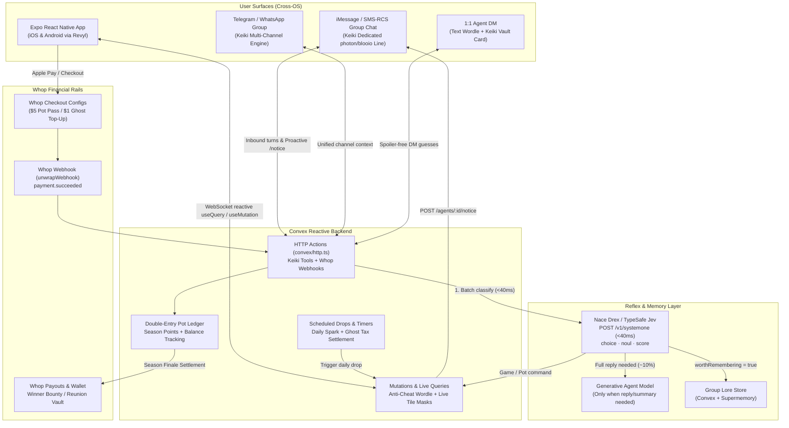

# Potluck — System & Product Design Document
**Event:** Y Combinator Consumer Mobile Hackathon (November 15, 2026 · 6:00 PM PST Submission)  
**Stack:** Expo (React Native) · Revyl · Convex · Keiki (`@onkeiki/agents`) · Whop (`@whop/sdk`) · TypeSafe Jev / Nace Drex (`systemOne`) · Capy (+ optional Supermemory)

---

## 1. Product Thesis & Core Loop

### Why Hometown & College Group Chats Die
When friends leave for different colleges—or scatter across majors, dorms, and internships—group chats die in a predictable pattern:
1. **High-friction catch-ups:** Nobody wants to break a two-week silence with an unprompted life essay, and "how is everyone" gets two tapbacks before dying again.
2. **Zero-stakes daily spam:** Pasting raw Wordle grids into iMessage creates clutter without shared stakes, live tension, or personal context.
3. **OS fragmentation:** One friend on Android or studying abroad fractures iMessage threads across SMS/RCS, WhatsApp, and Telegram.

### The Solution: Potluck
**Potluck** pairs a **cross-channel group chat agent** (living natively inside iMessage, SMS/RCS, and Telegram via **Keiki**) with a **real-time mobile companion app** (built in **Expo**, compiled and tested in the cloud on **Revyl**, powered by **Convex**) and **real $1 stakes** (powered by **Whop**).

Every day, Potluck drops one **60-second synchronous/async micro-game** into the group chat—defaulting to **Multiplayer Group Wordle**, rotating with **Friend-Lore Trivia** ("Who said this in October?") and **Campus Pin-Drop / Photo Dares**—backed by a real group money pot.

### Two Interlocking Retention Loops

| Loop | Mechanism | Why Users Come Back Tomorrow |
| :--- | :--- | :--- |
| **1. Daily Micro-Game + Pot Stakes (Compulsion)** | Daily Wordle / Trivia drop in the group chat. Friends play spoiler-free in the app or 1:1 DM while watching teammates' live tile colors (`🟩🟨⬛⬛🟩`) appear in real time. | Loss aversion + competition: miss the window and pay a **$1 Ghost Tax** into the pot, or lose ground on the Season Leaderboard. |
| **2. Cross-Chat Connector + Lore Utility (Genuine Value)** | The same Keiki agent bridges iMessage + Android/Telegram, answers `@potluck catch me up`, plans break linkups, splits group tabs, and quietly indexes group memories. | Even outside the 60-second game, Potluck is the shared glue that remembers who has midterms, who is visiting home, and when everyone is free. |

### Two Selectable Group Pot Modes (Whop)
Giving groups two modes during onboarding solves both competitive thrill and consumer/YC regulatory polish:
1. **Reunion Vault Mode (Default / Recommended for Demo):** Everyone loads a $5 Season Wallet via Whop. Staying on streak protects your balance; ghosting a daily round moves **$1 into the Group Reunion Vault**, unlocked together when the crew meets up IRL (Thanksgiving dinner, summer trip, concert tickets).
2. **Crown Bounty Mode (Skill Competition):** Everyone contributes $1/round (or $5/season) into a **skill-based prize pool** (pure Wordle accuracy + speed + trivia; zero RNG). At season end, Whop pays out 1st place (or 60% / 30% / 10%).

---

## 2. Critical Technical Research Findings (Read Before Coding)

Researching the exact November 2026 documentation for each sponsor surfaced five architectural constraints we must design around from hour one:

1. **Keiki Group Chats Require `photon` or `blooio` Dedicated Lines:**
   - Per Keiki's channel docs (`onkeiki.com/docs/cloud-agents`), `features.groupChats: true` **only works on dedicated `photon` or `blooio` iMessage lines** and **Telegram groups**. Lines on `linq` or shared join-code pools ignore group messages (`group_chats_unsupported`).
   - **Action:** Grab a dedicated `photon`/`blooio` line from the Keiki sponsor booth immediately, and wire the `telegram()` plugin in parallel (same Keiki group engine, zero provisioning wait, instant cross-OS backup).
2. **Keiki Interactive Cards Are 1:1 DM Only (Not Group Chats):**
   - Keiki's `features.card_app` / Keiki Vault web cards are intentionally restricted to **direct 1:1 conversations**, never group threads.
   - **Action:** Keep the **Group Chat** clean as the **Game Master & Scoreboard** (rich deep links `potluck://round/<id>`, native tapbacks via `react_to_message`, confetti via `effect: "confetti"`, and proactive drops via `POST /api/v1/developer/agents/<id>/notice`). Actual Wordle guessing happens **spoiler-free** either in the **Expo Mobile App** (primary) or via **1:1 DM with the agent** (fallback for friends without the app installed yet).
3. **Avoid $1 Card Processing Drag with a $5 Whop Pot Pass:**
   - Charging a raw credit card $1.00 daily loses ~32% to fixed payment processor fees and adds daily checkout friction.
   - **Action:** Use Whop `checkoutConfigurations.create` (`one_time` $5.00 "Season Pot Load" via Apple Pay, plus optional $1 instant top-ups). Convex tracks exact $1.00 per-round stakes/penalties in a double-entry `ledgerEntries` table backed 1:1 by the Whop platform balance, then settles out via Whop Payouts / Transfers.
4. **System One (`Jev` / `Nace Drex`) Solves the "Annoying Group Bot" Latency Problem:**
   - Nace's **Drex** (`POST https://console.nace.ai/v1/systemone`, `nace-sdk`) is **wire-compatible** with TypeSafe's **Jev** (`@typesafe-ai/sdk`). Unlike chat LLMs that stream chain-of-thought for 1.5–3s, `systemOne()` returns calibrated probabilities over `choice`, `noul`, and `score` primitives in **~20–50ms** and cannot hallucinate malformed JSON.
   - **Action:** Put `systemOne()` directly in front of every group message and game transition so 90%+ of group messages resolve in <40ms (silent observation, native tapback, or instant tool dispatch) without invoking a heavy generative LLM.
5. **Windows + Mac (No Xcode) Mobile Strategy via Expo + Revyl:**
   - All 3 teammates iterate live with `npx expo start --tunnel` (instant hot reload on physical iOS & Android phones with zero local native toolchains).
   - Native compilation runs remotely on **Revyl's cloud macOS 26.6 (Xcode 27) and Android runners** (`tools.mobile.build` / `revyl build`), installing directly onto cloud **iPhone 18 Pro** and **Pixel 7** devices (`tools.capy.phone`) and exporting an installable `.apk` + live Expo iPhone build for the 7:00 PM stage demo.

---

## 3. End-to-End System Architecture



---

## 4. Detailed Subsystem Specifications

### 4.1 Speed Layer: TypeSafe Jev / Nace Drex (`systemOne`)
Because Drex (`https://console.nace.ai/v1`) and TypeSafe Jev (`@typesafe-ai/sdk`) share the exact `systemOne` wire protocol, we write one thin wrapper in `convex/lib/systemOne.ts` that works with either `NACE_API_KEY` or `TYPESAFE_API_KEY` via a single environment variable switch.

**Four Production Hot Paths for `systemOne()`:**

1. **Group Chat Turn-Taking & Intent Router (~30ms, 1 batched call per message):**
   ```ts
   import { TypeSafeClient, choice, noul, score } from "@typesafe-ai/sdk";

   const s1 = new TypeSafeClient({
     apiKey: process.env.NACE_API_KEY ?? process.env.TYPESAFE_API_KEY,
     baseURL: process.env.NACE_API_KEY ? "https://console.nace.ai/v1" : undefined,
   });

   export async function triageGroupMessage(input: {
     sender: string;
     text: string;
     recentWindow: string[];
     activeRoundOpen: boolean;
     unplayedCount: number;
   }) {
     const { answers } = await s1.systemOne({
       state: input,
       questions: {
         routing: choice("How should the group chat agent handle this message?", {
           silent_observe: "Normal friend chatter not directed at the bot",
           tapback_only: "Funny moment, roast, hype, or milestone deserving a quick reaction only",
           run_tool: "Direct request or implied need for a game, pot check, bill split, recap, or hangout poll",
           conversational_reply: "Direct question or banter addressed to the agent needing a short text reply",
         }),
         tapback: choice("If reacting with an iMessage tapback, which fits best?", {
           none: "No reaction needed",
           laugh: "Joke, roast, or funny fail",
           love: "Wholesome update, support, or good news",
           emphasize: "Hype, clutch Wordle solve, or urgent plan",
           question: "Confusing claim",
         }),
         toolIntent: choice("Which utility or game action matches best?", {
           none: "Not a tool trigger",
           drop_wordle: "Start or fetch today's Wordle / game link",
           pot_status: "Check prize pot, leaderboard, or pay $1 buy-in",
           catch_me_up: "Summarize missed group chat messages",
           plan_hangout: "Coordinate dates/times to meet up",
           split_expense: "Split a bill or request money from the group",
         }),
         saveToLore: noul("Does this message reveal a personal life update, school/internship milestone, travel date, or memorable quote worth saving for future friend trivia?", {
           true: "Contains durable personal fact, funny quote, or upcoming trip",
           false: "Ephemeral logistics or filler",
         }),
         chatWarmth: score("How active and connected is the group right now?", [
           "Cold or awkward silence",
           "Low energy logistics",
           "Healthy casual banter",
           "High-energy conversation—do not interrupt with scheduled prompts",
         ]),
       },
     });
     return answers;
   }
   ```
2. **Adaptive Wordle & Lore Curating (`score`):** Ranks candidate 5-letter words (mixing standard NYT-tier words with custom group-themed 5-letter words like `BEARS`, `DORMZ`, `BOBA1` -> alpha-only `CACAO`, `STUDY`, `PIZZA`, `PRANK`) so difficulty matches the group's solve rate.
3. **Smart Drop Timing (`score`):** Before a scheduled cron interrupts a group chat, `chatWarmth` checks the last 10 messages—delaying a game drop by 30 minutes if friends are in the middle of a serious conversation.
4. **Multimodal Photo-Dare Verification (`noul` + `images[]`):** Both Jev and Drex accept `images[]` in `state`. For bonus flash rounds (*"Snap grass or coffee in 5 minutes to save your streak"*), `systemOne()` verifies image authenticity in <50ms with calibrated confidence (`answers.validSubmission.confidence > 0.80`).

---

### 4.2 Gameplay Mechanics: Anti-Spoiler Live Multiplayer Wordle + Rotating Modes

#### Primary Mode: Group Wordle (Default Daily Ritual)
- **Synchronized Secret, Private Boards:** At drop time (or manual "Start Round" in demo), Convex selects one 5-letter target word for `groupId + dateKey`.
- **Zero-Spoiler Live Presence:** Inside the Expo app's `round/[id]` screen, a header strip displays avatars for every member in the group chat alongside **live 5x6 mini-grids showing ONLY colors (`🟩`, `🟨`, `⬛`)** updated reactively via Convex `useQuery` on every guess. Your friends' actual letters remain stripped server-side until *you* complete (win or 6/6) the board.
- **Scoring Formula (Skill-Based, Deterministic):**
  - Solve in 1: `600 pts` · 2: `500 pts` · 3: `400 pts` · 4: `300 pts` · 5: `200 pts` · 6: `100 pts` · X/6: `25 participation pts` (protects against Ghost Tax!).
  - **Speed Tiebreaker Bonus:** `max(0, 120 - elapsedSeconds)` (up to `+120 pts`), rewarding fast focus without punishing async timezones (timer starts when *you* open the round!).
- **1:1 Text Fallback:** If a friend doesn't open the app, they can text their 5-letter guess directly in a 1:1 DM with the Keiki agent (`STARE` -> `🟩⬛🟨⬛🟩 (1/6)`), hitting the exact same Convex `submitGuess` mutation.
- **Group Chat Payoff:** The instant a player finishes, Convex calls Keiki's `notice` endpoint so the group chat receives crisp, trash-talk-ready updates:
  > *"Sritej cooked Wordle #1 in 3/6 (34s) -> +486 pts. Peyton is sweating on row 5... 1 person left before the $1 Ghost Tax hits the Thanksgiving Pot ($24.00)."*

#### Secondary Modes (Selectable in App / Chat)
1. **"Who Said It?" Lore Trivia (Friday Special):** Pulls saved quotes/facts from `loreMemories` (captured via `saveToLore` + Supermemory), generates 3 multiple-choice questions about the friend group itself, and awards double points.
2. **Flash Photo Check-In ("Proof of Life"):** 5-minute window to snap what's in front of you (verified instantly via Jev/Drex vision `noul`), stitched into a shared polaroid strip in the app's Memories tab so college friends actually *see* each other's daily lives.

---

### 4.3 Convex Data Model (`convex/schema.ts`)

```ts
import { defineSchema, defineTable } from "convex/server";
import { v } from "convex/values";

export default defineSchema({
  users: defineTable({
    name: v.string(),
    phone: v.optional(v.string()),          // Normalized E.164 (+1...) for Keiki binding
    telegramId: v.optional(v.string()),
    avatarUrl: v.optional(v.string()),
    campusOrCity: v.optional(v.string()),   // e.g., "UC Berkeley", "Austin, TX"
    whopUserId: v.optional(v.string()),
    createdAt: v.number(),
  })
    .index("by_phone", ["phone"])
    .index("by_telegram", ["telegramId"]),

  groups: defineTable({
    name: v.string(),                       // e.g., "Cupertino Day Ones"
    inviteCode: v.string(),                 // 6-char join code ("HOME26")
    keikiConversationId: v.optional(v.string()), // e.g., "imsg:chat:..." or "tg:..."
    potMode: v.union(v.literal("reunion_vault"), v.literal("crown_bounty")),
    stakeCents: v.number(),                 // Default 100 ($1.00)
    potBalanceCents: v.number(),            // Live verified Whop pot total
    reunionGoalTitle: v.optional(v.string()), // e.g., "Thanksgiving KBBQ Fund"
    reunionGoalCents: v.optional(v.number()),
    seasonEndsAt: v.number(),
    streakDays: v.number(),
    defaultGame: v.union(v.literal("wordle"), v.literal("lore_trivia"), v.literal("photo_dare")),
  })
    .index("by_invite_code", ["inviteCode"])
    .index("by_keiki_conv", ["keikiConversationId"]),

  groupMembers: defineTable({
    groupId: v.id("groups"),
    userId: v.id("users"),
    role: v.union(v.literal("admin"), v.literal("member")),
    walletBalanceCents: v.number(),         // Preloaded Whop pass balance
    seasonPoints: v.number(),
    currentStreak: v.number(),
    ghostCount: v.number(),
    joinedAt: v.number(),
  })
    .index("by_group", ["groupId"])
    .index("by_group_points", ["groupId", "seasonPoints"])
    .index("by_user", ["userId"]),

  rounds: defineTable({
    groupId: v.id("groups"),
    roundNumber: v.number(),
    dateKey: v.string(),                    // "2026-11-15"
    gameType: v.union(v.literal("wordle"), v.literal("lore_trivia"), v.literal("photo_dare")),
    secretWord: v.optional(v.string()),     // NEVER returned by client queries!
    promptText: v.optional(v.string()),
    status: v.union(v.literal("active"), v.literal("settled")),
    startsAt: v.number(),
    expiresAt: v.number(),
  })
    .index("by_group_status", ["groupId", "status"])
    .index("by_group_date", ["groupId", "dateKey"]),

  submissions: defineTable({
    roundId: v.id("rounds"),
    groupId: v.id("groups"),
    userId: v.id("users"),
    openedAt: v.number(),
    guesses: v.array(v.string()),           // Stripped for other players until viewer finishes
    tileMasks: v.array(v.string()),         // e.g., ["🟨⬛🟩⬛⬛", "🟩🟩🟩🟩🟩"] — safe for live spectator sync!
    status: v.union(v.literal("playing"), v.literal("won"), v.literal("lost")),
    pointsAwarded: v.number(),
    completedAt: v.optional(v.number()),
  })
    .index("by_round", ["roundId"])
    .index("by_round_user", ["roundId", "userId"]),

  ledgerEntries: defineTable({
    groupId: v.id("groups"),
    userId: v.id("users"),
    type: v.union(
      v.literal("whop_deposit"),
      v.literal("round_buy_in"),
      v.literal("ghost_tax"),
      v.literal("season_payout")
    ),
    amountCents: v.number(),
    whopCheckoutId: v.optional(v.string()),
    whopPaymentId: v.optional(v.string()),
    status: v.union(v.literal("pending"), v.literal("succeeded"), v.literal("failed")),
    note: v.string(),
    createdAt: v.number(),
  })
    .index("by_group", ["groupId"])
    .index("by_whop_payment", ["whopPaymentId"]),

  loreMemories: defineTable({
    groupId: v.id("groups"),
    speakerUserId: v.optional(v.id("users")),
    factOrQuote: v.string(),
    category: v.string(),                   // "quote" | "milestone" | "visit_date"
    createdAt: v.number(),
  }).index("by_group", ["groupId"]),
});
```

---

### 4.4 Whop Payment, Pot Escrow & Payout Architecture

1. **Creating a Pot Load / $1 Stake Checkout (`convex/whop.ts`):**
   - Uses `@whop/sdk` (`WhopClient`) inside a Convex `action`:
     ```ts
     const cfg = await whop.checkoutConfigurations.create({
       account_id: process.env.WHOP_PLATFORM_ACCOUNT_ID!,
       variant: {
         visibility: "visible",
         billing_type: "one_time",
         release_method: "buy_now",
         currency: "usd",
         initial_price: amountDollars, // $5.00 Season Pass or $1.00 Instant Stake
       },
       metadata: {
         groupId,
         userId,
         purpose: "pot_deposit",
       },
       redirect_url: `potluck://pot/${groupId}?funded=1`,
     });
     ```
   - On mobile, open the hosted Whop Apple Pay / Google Pay checkout URL in `expo-web-browser` (`openAuthSessionAsync`), or render `@whop/elements-react` `<Checkout>` inside a web modal.
2. **Webhook Confirmation (`convex/http.ts` -> `POST /webhooks/whop`):**
   - Validates signature via `unwrapWebhook(payload, { headers, key: process.env.WHOP_WEBHOOK_SECRET! })`.
   - On `payment.succeeded`, runs an internal idempotent Convex mutation checking `by_whop_payment` index -> increments `groups.potBalanceCents` and `groupMembers.walletBalanceCents` -> sends a Keiki proactive `notice` with `effect: "confetti"` to the group chat!
3. **Season Finale Payout:**
   - When `seasonEndsAt` arrives (or when you tap **"Settle Season Pot (Live Demo)"** during the 7:00 PM pitch), Convex calculates the #1 point scorer (Crown Bounty) or designated Group Reunion Host (Reunion Vault) and triggers a Whop Subaccount transfer / Payout link (`@whop/elements-react` `<Wallet>` portal or Whop Payouts API).

---

### 4.5 Keiki Multi-Channel Agent Wiring (`@onkeiki/agents`)

- **Agent Definition (`packages/keiki-agent/src/index.ts`):**
  - Synced to Keiki Cloud via `await kit.sync()` (`bun add @onkeiki/agents`).
  - `features.groupChats: true` enabled on dedicated iMessage line (`photon`/`blooio`) + Telegram bot.
  - **Authored Webhook Tools** pointing to `https://<deployment>.convex.site/keiki/tools/*`:
    1. `link_group(inviteCode)` — binds the active `imsg:chat:...` conversation ID to the Convex `groups` row in one text (`"@potluck join HOME26"`).
    2. `start_daily_round(gameType?)` — creates or fetches today's active Wordle/Trivia round and returns the universal deep link + current pot standings.
    3. `submit_dm_guess(word)` — lets players guess directly in 1:1 DM if they don't have the app open.
    4. `get_pot_and_pay_link(amountDollars?)` — mints a personalized $1 or $5 Whop checkout URL right inside iMessage.
    5. `catch_me_up(hours?)` — summarizes missed group banter, plans, and game drama.
    6. `propose_reunion_poll(title, options[])` — posts a numbered choice presentation (which Keiki automatically renders as interactive buttons on Telegram/Slack and clean numbered text replies on iMessage!).
- **Proactive Group Drops from Convex:**
  ```ts
  await fetch(`https://onkeiki.com/api/v1/developer/agents/${KEIKI_AGENT_ID}/notice`, {
    method: "POST",
    headers: {
      Authorization: `Bearer ${process.env.KEIKI_API_KEY}`,
      "Content-Type": "application/json",
    },
    body: JSON.stringify({
      phone: group.keikiConversationId, // Existing group or DM conversation identity
      text: `[SYSTEM_EVENT] Sritej solved Round #4 in 3/6 (29s) and took 1st place! Pot is now $28.00. Announce in 1 punchy sentence.`,
    }),
  });
  ```

---

### 4.6 Mobile App UI & Cross-OS Revyl Build Pipeline

#### Mobile App Screens (`apps/mobile/app/`)
Keep the mobile app focused on **4 tactile, high-craft screens** (inspired by Candle's warm intimacy + NYT Games' crisp haptics + Cash App's bold pot numbers):
1. **Home / Crew Switcher (`app/(tabs)/index.tsx`):**
   - Active group streak flame (`14 days`), **Live Pot Ticker (`$47.00 · Thanksgiving KBBQ Vault`)**, "Play Today's Drop (2/4 played)" hero card with countdown timer, and cross-campus status pills (*Sritej @ Berkeley · Peyton @ UCLA · Alex @ UIUC*).
2. **Live Multiplayer Arena (`app/round/[id].tsx`):**
   - Top bar: Live pulsing avatars + miniature 5x6 color-only tile grids of teammates playing right now via Convex reactive queries.
   - Center: Tactile 6x5 Wordle grid with flip animations (`react-native-reanimated`) and `expo-haptics` impact feedback on key presses, row reveals, and clutch solves.
   - Post-solve sheet: Instant rank, points breakdown, one-tap **"Talk Trash in iMessage"** button, and revealed teammate guesses once you finish.
3. **The Pot & Leaderboard (`app/(tabs)/pot.tsx`):**
   - Toggleable view of **Season Standings** (Points, Avg Guesses, Ghost Count) and **Whop Vault Ledger** (live deposits, $1 Ghost Taxes, "+ Add $1 / Load $5 Pass" Whop Apple Pay button, and **Demo Settle Pot** button).
4. **Group Lore & Catch-Up (`app/(tabs)/lore.tsx`):**
   - Auto-curated memory cards from group chats (saved quotes, photo check-ins, upcoming hometown break dates) + one-tap **"Catch Me Up"** digest for busy exam weeks.

#### Zero-Xcode Dev & Build Workflow (2 Windows + 1 Mac)
1. **Local UI Dev (All 3 Teammates):**
   - Run `npx convex dev` + `npx expo start --tunnel`. Any Windows or Mac laptop edits TypeScript/React Native and sees changes live in <1 second on physical phones.
2. **Cloud Native Compilation & Device QA on Revyl:**
   - Include `.revyl/config.yaml` and build via Capy's `tools.mobile.build` on Revyl's cloud runners:
     - **Android (`.apk`):** `bun install` -> `bunx expo prebuild --platform android` -> `./gradlew assembleRelease` -> installable `.apk` for physical Android demo devices + cloud Pixel 7.
     - **iOS (`.app`):** `bun install` -> `bunx expo prebuild --platform ios` -> `xcodebuild -sdk iphonesimulator` on Revyl's 12-core macOS 26.6 Xcode 27 runner -> tested live on Revyl cloud **iPhone 18 Pro** (`tools.capy.phone`).

---

## 5. Parallel 3-Person + Capy Execution Plan (Finish Before 6:00 PM PST)

| Window | Teammate 1 (Backend & AI) | Teammate 2 (Mobile Gameplay UI) | Teammate 3 (Keiki, Whop & Pitch) |
| :--- | :--- | :--- | :--- |
| **Phase 1 (60 min)**<br/>*Scaffold & Keys* | Init Convex project, deploy `schema.ts`, wire Nace/Jev `systemOne` router with API key. | Scaffold Expo Router app (`apps/mobile`), connect Convex provider, build theme + navigation tabs. | Claim Keiki dedicated iMessage line (`photon`/`blooio`) + Telegram bot at sponsor booth; grab Whop sandbox/live keys. |
| **Phase 2 (120 min)**<br/>*Core Loop* | Implement `submitGuess`, anti-cheat `getRoundLiveState`, points math, and Lore Trivia generator. | Build `round/[id].tsx` Wordle keyboard, flip animations, haptics, and live spectator mini-grids. | Wire `@onkeiki/agents` tools (`link_group`, `start_daily_round`, `submit_dm_guess`) + Whop checkout & webhook. |
| **Phase 3 (90 min)**<br/>*Integration & Cloud Build* | Wire proactive Keiki `/notice` triggers on round completion + Ghost Tax cron/demo trigger. | Build Pot/Vault screen, Lore timeline, deep linking (`potluck://`), and kick off **Revyl** iOS + Android builds. | End-to-end test real iMessage group chat -> phone tap -> $1 Whop checkout -> confetti group reply. |
| **Phase 4 (60 min)**<br/>*Polish & 90s Stage Demo* | Seed realistic "Hometown Crew" lore & 30-day history so leaderboards look lived-in. | Install Revyl `.apk` + physical iPhone build; verify zero layout bugs on cloud iPhone 18 Pro via Revyl. | Rehearse live **2-phone stage demo** (Phone A = real iMessage group chat; Phone B = live multiplayer Wordle + Whop payout). |

---

## 6. Winning 90-Second Demo Script for Judges (7:00 PM)

1. **0:00–0:15 (The Hook):** *"Raise your hand if your hometown group chat slowly died freshman year of college. Existing bots spam soulless green squares; Potluck gives your group chat a daily 60-second ritual with real $1 stakes toward your next reunion."*
2. **0:15–0:45 (Live Cross-Chat + Multiplayer Demo):** Trigger a live drop on stage. Show **Phone 1 (iMessage Group Chat)** receive the Keiki prompt. Two teammates open the link on **Phone 1 & Phone 2**—point out **live anonymized tile colors updating in real time** via Convex as both type guesses. Solve in 3 guesses -> watch Keiki fire an instant confetti roast back into iMessage!
3. **0:45–1:10 (Speed + Whop Stakes):** Send rapid-fire banter in the group chat—show **Nace/Jev System One** reacting with a native iMessage tapback in **35ms** without spamming text, while quietly saving a quote into **Friday Friend Trivia**. Tap **"+ $1 Ghost Tax / Fund Thanksgiving Pot"** via **Whop Apple Pay** -> watch the group pot tick up live and trigger **Season Finale Payout**.
4. **1:10–1:30 (Why It Scales):** *"Built from scratch today on Windows and Mac without Xcode using Capy, Revyl, Convex, Keiki, Whop, and System One. Every friend group already has a chat—Potluck gives them a reason to open it tomorrow."*
