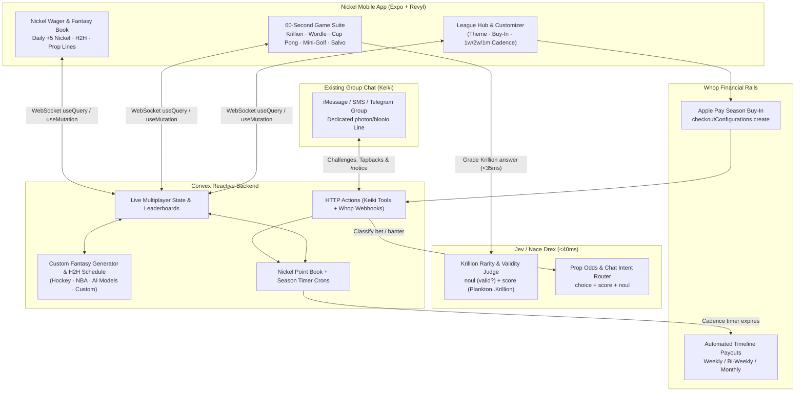

# Nickel — Product & System Design Document
**Event:** Y Combinator Consumer Mobile Hackathon (November 15, 2026 · 6:00 PM PST Submission)  
**Stack:** Expo (React Native) · Revyl · Convex · Keiki (`@onkeiki/agents`) · Whop (`@whop/sdk`) · TypeSafe Jev / Nace Drex (`systemOne`) · Capy

---

## 1. High-Level Vision: What Is Nickel?

**Nickel** turns any existing friend group into a **customizable Fantasy League + fast-play micro-game arena** with real-money season pots and daily point wagering—connected seamlessly to iMessage/SMS/Telegram.

- **Why "Nickel"?** Every day you show up, you get your **Daily Nickel** (**5 Nickel Points** / $0.05–$1.00 daily pot stake) to put on games, head-to-head challenges, and side bets (*"put a Nickel on it"*).
- **Fast (<45s) Viral & GamePigeon-Style Micro-Games:** Instead of slow 20-minute board games, every game in Nickel is engineered to finish in **15 to 60 seconds** inside the app:
  1. **One in a Krillion ("The Dive"):** Inspired by the viral *Krillion* rarity-trivia hit—a 25-second shot clock to name a valid answer to an open category where **rarer valid answers score higher** (*Plankton 10 pts → Schooler 30 → Rare 60 → Deep Cut 85 → **One in a Krillion 100 pts***), graded live in **30ms** by **Jev / Nace Drex `systemOne()`**! If two friends submit the exact same answer, they collide and split the points.
  2. **Wordle Blitz:** 5-letter speed race with live color-only spectator tiles (`🟩🟨⬛`) streaming over Convex WebSockets.
  3. **GamePigeon-Style Flick Physics (Cup Pong · Swish Hoops · 1-Hole Mini-Golf):** 30-second swipe-to-shoot physics challenges (5 ping-pong balls / basketballs or 1 Mark Rober-style trick-shot mini-golf hole; fewest strokes / highest streak wins).
  4. **5x5 Blitz Battleship ("Radar Salvo"):** Probability-condensed Battleship—place 2 mini-ships, fire one 5-shot salvo in 20 seconds, most direct hits wins immediately.
- **"Fantasy Anything" Custom Leagues:** Groups aren't locked into one template. When creating a league in the app, the commissioner customizes:
  - **League Fantasy Theme:** Pick **Arcade Mix** (rotating daily micro-games), **Pro Sports Fantasy** (NHL Hockey, NBA, NFL daily pick'ems + mini-game tiebreakers), or **Custom Niche Fantasy**—like a **Fantasy AI League** (draft OpenAI, Anthropic, Google, xAI, TypeSafe; bet Nickels on model drops/benchmarks + play AI-themed *One in a Krillion* rounds), **Campus/Dorm Fantasy**, or any custom topic!
  - **Custom Payout Timelines:** Set seasons to pay out **Weekly**, **Every 2 Weeks (Bi-Weekly)**, **Monthly**, **Per Semester**, or **Custom** (including a **2-Minute Blitz Season** for live hackathon demos), settled automatically through **Whop**.
- **App-First Experience + Seamless iMessage Glue:** Everything—playing games, building custom fantasy leagues, placing Nickel prop bets, challenging friends 1v1, and cashing out—happens natively inside **your own Nickel mobile app**, while **Keiki** connects directly to the group's existing iMessage/Telegram chat to fire challenges, trash-talk stragglers, and announce *"One in a Krillion!"* upsets.

---

## 2. Critical Technical Architecture & Sponsor Fit

1. **TypeSafe Jev / Nace Drex (`systemOne`) — Sub-40ms Rarity Judge, Odds Maker & Chat Router:**
   - Nace's **Drex** (`POST https://console.nace.ai/v1/systemone`) is wire-compatible with TypeSafe's **Jev** (`@typesafe-ai/sdk`).
   - **Killer Use Case #1 (Live *One in a Krillion* Grading in ~30ms):** Open-ended rarity games usually lag on slow LLMs. A single `systemOne()` call evaluates `isValid: noul(...)` and `rarityTier: score(..., ["Plankton", "Too Clever", "Schooler", "Rare", "Deep Cut", "One in a Krillion"])` in ~30ms with calibrated probabilities and zero JSON hallucinations!
   - **Killer Use Case #2 (Dynamic Prop Odds):** Computes instant Over/Under lines (`score`) for player challenges (*"Peyton Over/Under 3.5 Cup Pong cups"* or *"Sritej Over/Under 3.5 Wordle guesses"*).
   - **Killer Use Case #3 (iMessage Turn-Taking Gate):** Classifies group chat messages (`choice` + `noul`) in <40ms so the Keiki bot fires native tapbacks or parses `"@nickel 5 pts I beat Peyton in Mini-Golf"` without annoying chatter.
2. **Convex — Real-Time Multiplayer Arena, Custom Fantasy Engine & Point Ledger:**
   - Streams live spectator state (`useQuery`) across Wordle tile masks, Krillion ocean-depth meters, Cup Pong scores, and H2H fantasy scoreboard ticks.
   - Runs Convex `crons.ts` + scheduled functions to enforce custom league payout windows (7-day, 14-day, 30-day, or custom timestamp) and distribute the **Daily 5-Point Nickel Stipend**.
3. **Whop (`@whop/sdk` + `@whop/elements`) — Season Buy-Ins & Custom Timeline Payouts:**
   - Collects league buy-ins ($5, $10, or custom pot) via `whop.checkoutConfigurations.create` (Apple Pay / card).
   - Verifies deposits via `unwrapWebhook` (`payment.succeeded`) in `convex/http.ts`.
   - Settles the real-money prize pool automatically when the league's custom payout timer hits zero via Whop Payouts / Wallet transfers.
4. **Keiki (`@onkeiki/agents`) — Existing Group Chat Connector:**
   - Uses a dedicated `photon` or `blooio` iMessage line (`features.groupChats: true`) + Telegram/SMS fallback so existing friend group chats link to a Nickel league via a 6-character code (`"@nickel link KRILL5"`).
   - Receives proactive `POST /api/v1/developer/agents/<id>/notice` events from Convex whenever someone drops a 1v1 challenge, hits a *One in a Krillion* answer, or wins a bi-weekly Whop payout.
5. **Expo + Revyl + Capy — Zero-Xcode Cross-Platform Mobile Pipeline:**
   - Built in Expo (React Native + `react-native-reanimated` + `react-native-svg` / 60fps gesture physics for Cup Pong, Hoops & Mini-Golf + `expo-haptics`).
   - Instant live reload across your 2 Windows laptops + 1 Mac (`npx expo start --tunnel`), while **Revyl** compiles native Android `.apk` and cloud iOS (`iPhone 18 Pro`) builds via `tools.mobile.build` and `tools.capy.phone`.

---

## 3. System Architecture Diagram



---

## 4. Micro-Game Specifications (Strictly 15–60 Seconds Per Play)

| Game | Target Time | Core Mechanic & Skill Expression | Anti-Cheat / Scoring in Convex |
| :--- | :---: | :--- | :--- |
| **1. One in a Krillion** *(Signature)* | **25 sec** | Open prompt tailored to the league (e.g., *"Name an NHL goalie with 300+ wins"* or *"Name an open-weight AI model under 10B params"* or *"Name a fruit with one seed"*). | Jev/Nace `systemOne()` checks factual validity (`noul`) + rarity (`score` 0–5): **Plankton (10)**, **Too Clever (15)**, **Schooler (30)**, **Rare (60)**, **Deep Cut (85)**, **One in a Krillion (100)**. Duplicate answers in the same group split points! |
| **2. Wordle Blitz** | **45 sec** | Solve the shared 5-letter word while watching friends' live `🟩🟨⬛` rows flip in real time. | Target word stays server-only; `(7 - guesses) * 20 + speedBonus` points. |
| **3. Cup Pong / Swish Hoops** | **30 sec** | 5-ball swipe-flick physics challenge (`PanResponder` + 60fps trajectory arc; subtle wind/rim physics inspired by Mark Rober's carnival physics!). | Trajectory seed + shot vectors verified; streak multipliers (`+10, +20, +35, +50, +75`). |
| **4. 1-Hole Trick Mini-Golf** | **25 sec** | One procedural geometric obstacle hole per day; pull-back slingshot putter. | Par 3 scoring + closest-to-cup millimeter tiebreaker so 1v1 bets never tie. |
| **5. 5x5 Blitz Salvo (Battleship)** | **30 sec** | Tap 5 radar tiles at once against a hidden 3-ship probability grid (inspired by Mark Rober's Battleship heatmap!). | Server holds ship coordinates; hits + sunk-ship bonuses resolve in one volley. |

---

## 5. Custom "Fantasy Anything" + Nickel Wagering Mechanics

### 5.1 League Customization Flow (30-Second Commissioner Setup)
1. **Pick Your Timeline (Payout Schedule):**
   - `7 Days (Weekly)` · `14 Days (Bi-Weekly)` · `30 Days (Monthly)` · `Semester` · `Demo Blitz (3 Mins)`.
2. **Pick or Prompt Your Fantasy Mode:**
   - **Preset Arcade League:** Daily rotation of Krillion, Wordle, Cup Pong, Mini-Golf, and Salvo.
   - **Sports Fantasy Lite (Hockey / Basketball / Football):** Roster 3 real teams/players or pick daily real-game props + play daily mini-games for bonus fantasy points.
   - **Custom Topic Fantasy ("Prompt Any League"):** Type *any* obsession—e.g., **"Fantasy AI Models"**, **"Formula 1"**, **"Valorant"**, or **"Berkeley CS Surviving Finals"**. Convex generates custom team drafts, custom daily prop questions, and custom *One in a Krillion* prompts for that exact niche!
3. **Set the Stakes (Whop + Daily Nickels):**
   - Optional Whop cash buy-in ($1–$25 per cycle) + automatic **+5 Nickel Points** credited every morning to every member.
   - Players stake 1–20 Nickels on:
     - **Daily Over/Unders:** *"Bet 5 Nickels Peyton scores <60m depth on today's Krillion"* (line set dynamically by Jev/Nace `score`).
     - **1v1 Instant Challenges:** Tap a friend (or text `@nickel challenge @Sritej mini-golf 10 nickels`) to launch a head-to-head duel.
     - **"One in a Krillion" Parlay:** 3-leg group parlay paying 10x Nickels if hit!

---

## 6. Convex Schema (`convex/schema.ts`)

```ts
import { defineSchema, defineTable } from "convex/server";
import { v } from "convex/values";

export default defineSchema({
  users: defineTable({
    name: v.string(),
    handle: v.string(),
    phone: v.optional(v.string()),
    avatarColor: v.string(),
    whopUserId: v.optional(v.string()),
    createdAt: v.number(),
  }).index("by_phone", ["phone"]),

  leagues: defineTable({
    name: v.string(),                       // e.g. "Hometown Degens" or "Fantasy AI Lab"
    inviteCode: v.string(),                 // e.g. "KRILL5"
    keikiConversationId: v.optional(v.string()),
    themeType: v.union(
      v.literal("arcade_mix"),
      v.literal("hockey"),
      v.literal("basketball"),
      v.literal("football"),
      v.literal("ai_models"),
      v.literal("custom")
    ),
    customThemePrompt: v.optional(v.string()), // e.g. "Frontier AI labs, benchmarks, and model releases"
    cadence: v.union(
      v.literal("demo_blitz"),
      v.literal("weekly"),
      v.literal("biweekly"),
      v.literal("monthly"),
      v.literal("custom_days")
    ),
    cadenceDays: v.number(),
    buyInCents: v.number(),                 // e.g. 500 ($5.00 via Whop)
    potBalanceCents: v.number(),
    dailyNickelAllowance: v.number(),       // Default: 5 Nickels / day
    enabledGames: v.array(v.string()),      // ["krillion", "wordle", "cup_pong", "mini_golf", "salvo"]
    seasonNumber: v.number(),
    seasonStartsAt: v.number(),
    seasonEndsAt: v.number(),
    payoutSplit: v.array(v.number()),       // e.g. [70, 30] or [100]
  })
    .index("by_invite_code", ["inviteCode"])
    .index("by_keiki_conv", ["keikiConversationId"]),

  memberships: defineTable({
    leagueId: v.id("leagues"),
    userId: v.id("users"),
    role: v.union(v.literal("commissioner"), v.literal("player")),
    nickelBalance: v.number(),              // Spendable wager points (+5/day)
    seasonFantasyPoints: v.number(),        // Determines Whop payout rank
    wins: v.number(),
    losses: v.number(),
    krillionCount: v.number(),              // Lifetime "One in a Krillion" pulls!
    buyInPaid: v.boolean(),
    lastStipendDate: v.optional(v.string()),
  })
    .index("by_league", ["leagueId"])
    .index("by_league_points", ["leagueId", "seasonFantasyPoints"])
    .index("by_user", ["userId"]),

  rounds: defineTable({
    leagueId: v.id("leagues"),
    gameType: v.union(
      v.literal("krillion"),
      v.literal("wordle"),
      v.literal("cup_pong"),
      v.literal("mini_golf"),
      v.literal("salvo")
    ),
    title: v.string(),
    promptOrConfig: v.any(),                // Category prompt, obstacle seed, etc.
    secretServerState: v.optional(v.any()), // Hidden target word or 5x5 ship coords
    status: v.union(v.literal("open"), v.literal("settled")),
    challengerId: v.optional(v.id("users")), // Set if 1v1 challenge
    opponentId: v.optional(v.id("users")),
    stakeNickels: v.number(),
    expiresAt: v.number(),
  }).index("by_league_status", ["leagueId", "status"]),

  plays: defineTable({
    roundId: v.id("rounds"),
    leagueId: v.id("leagues"),
    userId: v.id("users"),
    publicSpectatorState: v.any(),          // Live tile masks, shot streak, or dive depth
    rawSubmission: v.optional(v.any()),     // Answer string, guesses, stroke count
    tierLabel: v.optional(v.string()),      // "Plankton" .. "One in a Krillion"
    scorePoints: v.number(),
    durationMs: v.number(),
    completedAt: v.optional(v.number()),
  })
    .index("by_round", ["roundId"])
    .index("by_round_user", ["roundId", "userId"]),

  wagers: defineTable({
    leagueId: v.id("leagues"),
    roundId: v.optional(v.id("rounds")),
    creatorId: v.id("users"),
    takerId: v.optional(v.id("users")),
    marketText: v.string(),                 // e.g. "Peyton hits Rare+ (60+ pts) on Krillion"
    lineValue: v.optional(v.number()),
    side: v.union(v.literal("over"), v.literal("under"), v.literal("h2h")),
    stakeNickels: v.number(),
    payoutMultiplier: v.number(),
    status: v.union(v.literal("open"), v.literal("locked"), v.literal("won"), v.literal("lost"), v.literal("push")),
    createdAt: v.number(),
  }).index("by_league_status", ["leagueId", "status"]),

  transactions: defineTable({
    leagueId: v.id("leagues"),
    userId: v.id("users"),
    kind: v.union(v.literal("whop_buy_in"), v.literal("whop_payout"), v.literal("daily_nickel"), v.literal("wager_settle")),
    amountCents: v.optional(v.number()),
    amountNickels: v.optional(v.number()),
    whopPaymentId: v.optional(v.string()),
    createdAt: v.number(),
  })
    .index("by_league", ["leagueId"])
    .index("by_whop_payment", ["whopPaymentId"]),
});
```

---

## 7. Jev / Nace Drex `systemOne()` Implementation for *One in a Krillion*

```ts
import { TypeSafeClient, noul, score, choice } from "@typesafe-ai/sdk";

const s1 = new TypeSafeClient({
  apiKey: process.env.NACE_API_KEY ?? process.env.TYPESAFE_API_KEY,
  baseURL: process.env.NACE_API_KEY ? "https://console.nace.ai/v1" : undefined,
});

const TIER_TABLE = [
  { label: "Plankton", points: 10, depthMeters: 100 },
  { label: "Too Clever", points: 15, depthMeters: 150 },
  { label: "Schooler", points: 30, depthMeters: 300 },
  { label: "Rare", points: 60, depthMeters: 600 },
  { label: "Deep Cut", points: 85, depthMeters: 850 },
  { label: "One in a Krillion", points: 100, depthMeters: 1000 },
] as const;

export async function gradeKrillionDive(categoryPrompt: string, playerAnswer: string, leagueContext: string) {
  const { answers } = await s1.systemOne({
    state: {
      leagueContext,
      categoryPrompt,
      submittedAnswer: playerAnswer.trim(),
    },
    questions: {
      valid: noul("Is submittedAnswer a factually accurate, real, non-fabricated member of categoryPrompt?", {
        true: "Factually accurate and strictly satisfies every constraint of categoryPrompt",
        false: "Incorrect, made up, vague, or violates a constraint of categoryPrompt",
      }),
      obscurity: score("Assuming submittedAnswer is valid, how obscure or rare of a pull is it compared to what an average player would say first?", [
        "Plankton: top-3 most obvious textbook answer everyone thinks of first",
        "Too Clever: cliché 'fake obscure' answer many people try when avoiding the #1 pick",
        "Schooler: solid recognizable pick, moderately common",
        "Rare: genuinely uncommon valid answer most players miss under a 25s timer",
        "Deep Cut: specialized deep-knowledge answer only enthusiasts recall",
        "One in a Krillion: razor-sharp, indisputable, ultra-obscure valid pull",
      ]),
    },
  });

  if (!answers.valid.noul) {
    return { valid: false, label: "Wipeout", points: 0, depthMeters: 0 };
  }
  const idx = Math.min(5, Math.max(0, Math.round(answers.obscurity.score)));
  return { valid: true, ...TIER_TABLE[idx], rawScore: answers.obscurity.score };
}
```

---

## 8. Mobile App Structure & 3-Person Parallel Build Plan

### Four Crisp Mobile Tabs (`apps/mobile/app/(tabs)/`)
1. **`Arena` (`index.tsx`):** Active League header (Pot `$40.00` · Payout in `11d 4h` · Your Balance `🪙 25 Nickels`), **"Today's Dive: One in a Krillion"** hero button, quick-launch carousel for **Wordle Blitz**, **Cup Pong**, **Mini-Golf**, and **5x5 Salvo**, plus active 1v1 challenges.
2. **`Wagers` (`wagers.tsx`):** Kalshi-style clean order cards for your friend group—tap Over/Under prop lines on your friends before they play, fire a 5-Nickel 1v1 challenge, or build a 3-leg **"One in a Krillion" Parlay**.
3. **`League` (`league.tsx`):** Fantasy H2H weekly matchups, Season Standings, **Whop Buy-In & Instant Demo Payout**, and **"+ Create Custom League"** wizard (pick Hockey / NBA / AI Models / Custom Prompt + Weekly / Bi-Weekly / Monthly payout cadence).
4. **`Chat Sync` (`connect.tsx`):** One-tap iMessage / Telegram group link code (`@nickel link KRILL5`), live feed of group trash talk & bot announcements, and "Poke Stragglers" button.

### Division of Labor (Finish Before 6:00 PM PST)
- **Track A — Convex + System One Engine:** Deploy `schema.ts`, build `gradeKrillionDive` + `triageGroupMessage` on Nace/Jev `systemOne()`, Wordle & Salvo anti-cheat mutations, custom Fantasy AI/Sports prompt generator, and Daily Nickel + Season Payout crons.
- **Track B — Expo Arcade & Fantasy App + Revyl Builds:** Build the **Nickel** dark/neon-mint mobile UI, the 4 playable <45s games (*One in a Krillion* 25s dive UI, *Wordle Blitz*, *Cup Pong / Mini-Golf* swipe physics, *5x5 Salvo*), League Customizer, and run cloud Android `.apk` + iOS `iPhone 18 Pro` builds on **Revyl**.
- **Track C — Keiki iMessage Agent + Whop Rails:** Connect `@onkeiki/agents` on a dedicated `photon`/`blooio` line + Telegram, wire Whop Apple Pay buy-in checkouts + webhook + season payout demo, and script the 90-second 2-phone live stage pitch.
