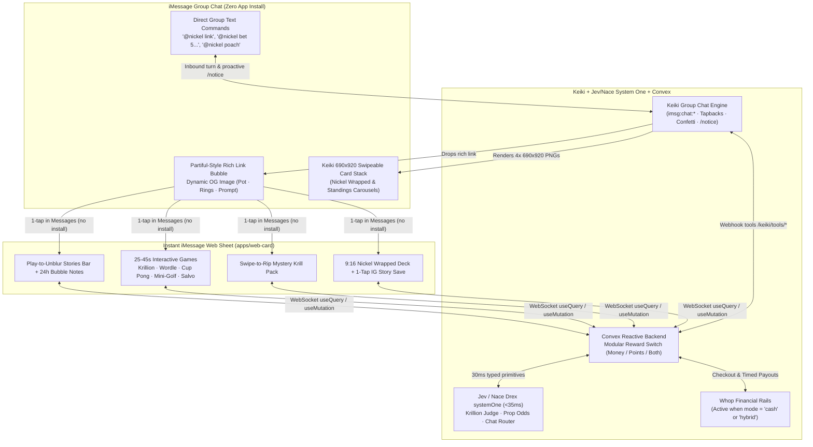

# Nickel — iMessage-Native Group Chat League & Micro-Game Spec (`sritej/main`)

**Event:** Y Combinator Consumer Mobile Hackathon (November 15, 2026 · 6:00 PM PST Submission · 7:00 PM Live Demos)  
**Core Product Paradigm:** **Zero-App-Install, Partiful-Style iMessage Integration** — 100% playable inside iMessage text + instant Partiful-style iMessage Rich Link Cards (`SFSafariViewController` sheet) + Keiki 690×920 Swipeable Card Stacks. No App Store download required.  
**Stack:** Capy · Revyl (Cloud iPhone 18 Pro + Mobile Web Testing) · Convex (`convex@1.50.0`) · Keiki (`@onkeiki/agents@0.1.7` Group Chats + Rich Cards) · Whop (`@whop/sdk@2.8.1`) · TypeSafe Jev (`@typesafe-ai/sdk@0.7.0`) / Nace Drex (`nace-sdk@0.8.0`)

---

## 1. The Zero-App, Partiful-for-Group-Games Paradigm

Why did **Partiful** win group social coordination? Because **nobody in an iMessage group chat will stop to download a 150 MB App Store app and create an account** just to RSVP or play a 30-second game with friends.

**Nickel** works the exact same way—**zero app download required**:

1. **The iMessage Group Chat IS the Lobby (Keiki `features.groupChats: true`):**
   - You add Nickel's phone number to your existing iMessage group chat (`imsg:chat:<id>` on a dedicated Keiki `photon` or `blooio` line).
   - You can play, bet Nickels, poach AFK friends, check standings, and talk trash **purely by texting in the group chat** (`@nickel bet 5 Peyton under 50`, `@nickel poach Sritej`, or texting your *One in a Krillion* / *Wordle* answer directly).
2. **Partiful-Style Interactive iMessage Cards (Zero-Install Instant Web Sheet):**
   - Whenever Nickel drops a daily game, a 1v1 challenge, a live prop book, or a **Nickel Wrapped** recap into iMessage, it sends a **Partiful-style Rich Card URL** (`https://<domain>/c/<shortId>?u=<signedMemberToken>`).
   - **Dynamic Live OpenGraph Preview (`GET /api/og/[cardId]`):** iOS Messages automatically renders the URL's dynamic `og:image` + `og:title` as a **large, custom-styled visual card bubble** directly inside the iMessage thread showing the live pot (`$25.00` or `250 🪙`), the game prompt, who is still blurred/unplayed (`3/5 Played`), and the countdown timer.
   - **One-Tap Instant Sheet (No Login Wall):** Tapping the card in iMessage opens an ultra-fast, haptic mobile sheet right over Messages (`100dvh`, pre-authenticated via the signed member link or 1-tap phone claim) where players flick a 25-second **Cup Pong / Mini-Golf** shot, tap a **5x5 Salvo** grid, rip their **Mystery Krill Pack**, unblur friends' **24h Bubble Notes**, and tap **"Back to iMessage"** (via Keiki's `sms:` return link!).
3. **Keiki Native 690×920 Swipeable Image Stacks (`render_cards` / `send_file`):**
   - Using Keiki's new `cards` capability (`https://onkeiki.com/docs/cards`), multi-slide moments—like **Sunday Nickel Wrapped** or **Weekly Matchup Recaps**—render as **four `690×920` dark cards** delivered in one message, which iOS iMessage automatically displays as a **native swipeable card stack** right inside the chat bubble!
4. **1:1 Keiki Vault App Cards (`presentation: { type: "app", live: true }`):**
   - When a player DMs the agent 1:1 (e.g., to submit a secret *Wordle* or *One in a Krillion* answer without spoiling the group chat), the tool also returns Keiki's `presentation: { type: "app", id, url, live: true }` so the card renders inline inside Messages, with automatic fallback to the Partiful-style rich preview link inside group threads.

---

## 2. Modular Rewards & Payments Switch (`points_only` | `cash_only` | `hybrid`)

Every friend group has a different appetite for money vs. points, and we also want a **single switch on our end** to flip the entire product (or any individual league) between pure points, pure cash, or both in one click.

### 2.1 The Three-Way `rewardMode` Switch (`convex/schema.ts` + UI Header Toggle)

We store `rewardMode` on every `leagues` document (defaulting to global `process.env.DEFAULT_REWARD_MODE ?? "hybrid"`), and expose an instant **3-way segmented switch** in the Commissioner bar and in iMessage (`@nickel mode points | cash | hybrid`):

| Mode | How Daily Stakes Work | How Season Payouts Work | Whop Integration State |
| :--- | :--- | :--- | :--- |
| **`"points_only"`** *(100% Free / Arcade & Bragging Rights)* | Players get **+5 Daily Nickels (🪙 pts)** every morning, poach unclaimed Nickels from AFK friends, rip Mystery Packs, and wager points on Over/Unders & 1v1 duels. | Season winner takes the **Crown Trophy** + custom **Group Dare / Punishment** (e.g., *"Last place buys boba / wears rival jersey"*) announced on the Nickel Wrapped podium. | **Whop UI toggled off** (`whopEnabled: false`). Zero payment friction; 100% pure point economy. |
| **`"cash_only"`** *(Pure Real-Money Pot)* | Players fund the league pot via **Whop Apple Pay** ($1–$25 buy-in or $1 Ghost Tax per missed day). Wagers and game wins directly shift each player's **% share of the Cash Pot**. | When the custom timeline expires (Weekly / Bi-Weekly / Monthly), **Whop** automatically pays out the USD pot (`70% / 30%` or `100%` winner-take-all). | **Whop Checkout + Wallet Payouts primary.** All balances display in `$USD` (`$5.00`). |
| **`"hybrid"`** *(Both Money Pot + Daily Nickel Points — Default)* | **Best of both worlds:** Everyone puts a one-time **$5 Buy-In** into the Whop Season Pot, AND gets **+5 Daily Nickel Points (🪙)** every day to wager, poach, and parlay without swiping a card daily. | Daily Nickel wagers & micro-game scores accumulate **Season Fantasy Points**; at season end, the #1 and #2 point leaders win the **Whop USD Cash Pot**! | **Both active:** Whop handles the Season Buy-In & Finale Payout; Convex handles fast daily Nickel point betting. |

### 2.2 Single Unified Currency Formatter (`formatStake(league, amount)`)
In our shared helper (`lib/rewardMode.ts`), every card, iMessage bubble, and OpenGraph image checks `league.rewardMode`:
- `points_only` -> renders `🪙 25 Nickels` and `"Season Prize: Loser Buys KBBQ"`
- `cash_only` -> renders `💵 $25.00 Pot` and `"Whop Instant Payout"`
- `hybrid` -> renders `💵 $25.00 Whop Pot · 🪙 25 Nickels`

Flipping the switch in the Demo Bar or via `@nickel mode points` updates every iMessage response, OpenGraph card preview, prop slip, and leaderboard across the entire app in `<50ms` via Convex reactivity!

---

## 3. Deep Dive: How Each Subsystem Works

### 3.1 Keiki's New Group Chat Feature (`@onkeiki/agents@0.1.7`)
From our inspection of Keiki's latest docs (`onkeiki.com/docs/cloud-agents#group-chats` and `onkeiki.com/blog/changelog-2026-11-09`):
1. **Group Chat Conversation Identity (`imsg:chat:<provider_chat_id>`):**
   - Turning on `features.groupChats: true` on a dedicated `photon` or `blooio` iMessage line (or Telegram group) gives each group chat its own persistent conversation ID (`imsg:chat:...`) while labeling every inbound message with the sender's name and phone/handle (`ctx.phone`, `ctx.channel.userId`, `ctx.channel.isDirect`).
2. **Built-In Mention & 5-Minute Context Window:**
   - Keiki's group-chat engine automatically observes all group messages quietly as context and triggers the agent when:
     - Someone leads with its name (`"Nickel, drop today's game"`) or `@nickel` anywhere in the text.
     - Someone replies in a thread to one of Nickel's messages.
     - Someone sends a follow-up within 5 minutes of Nickel's last group message (e.g., `"put 5 on Peyton under"` right after Nickel posts today's drop)—filtered automatically so the bot never interrupts unrelated friend banter.
3. **Native iMessage Tapbacks, Threaded Replies & Screen Effects:**
   - Nickel uses Keiki's built-in `react_to_message` (`laugh`, `love`, `emphasize`, `question`), `reply` (threaded to the specific sender's bubble), and `effect` (`"confetti"`, `"fireworks"`, `"lasers"`) on `POST {turnUrl}/messages` when a player hits a *One in a Krillion* (100 pts) or wins a season payout.
4. **Proactive Group Drops (`POST /api/v1/developer/agents/<agent-id>/notice`):**
   - When a player finishes a game inside the Partiful-style web card sheet—or when the evening **Nickel Poach Window** opens—Convex fires a proactive `notice` to `imsg:chat:<id>`. Keiki wakes the group turn and posts the live update right back into the iMessage group thread!

---

### 3.2 Partiful-Style iMessage Card Engine (Dynamic OG + Instant Web Sheet)
How does a link look like a native interactive card inside an iMessage group chat without an app?
1. **Short Card Links (`/c/[cardId]`):**
   - Every game drop, 1v1 duel, prop slip, and Season Wrapped generates a clean URL: `https://<host>/c/krill-42`.
2. **Dynamic OpenGraph Image Route (`/api/og/[cardId]`):**
   - Served by Next.js / Convex HTTP action using `next/og` (`ImageResponse` / Satori SVG-to-PNG at `1200×630`):
   - Renders a high-contrast dark-obsidian & electric-mint visual card showing:
     - **Top Pill:** League Name (`HOMETOWN DEGENS`) + Active Mode Badge (`$25 WHOP POT` or `🪙 POINTS LEAGUE`)
     - **Center:** Game Title (`ONE IN A KRILLION · 25s DIVE`) or Matchup (`SRITEJ vs PEYTON · MINI-GOLF`)
     - **Avatar Strip:** Live status rings for every friend in the group chat (`🟢 Played [Blurred]`, `⚪ Unclaimed 5 Nickels`)
     - **CTA Footer:** `"Tap to Play in 25s & Unblur Chat →"`
   - When iMessage fetches `/c/krill-42`, Apple's `imagent` crawler caches that crisp image as a **clickable Partiful-style card** right in the chat! (We append a cache-busting version query `?v=<playCount>` whenever new rounds drop so iMessage always shows fresh state.)
3. **Zero-Install Instant Sheet (`apps/web-card`):**
   - Tapping the iMessage card opens the mobile viewport sheet in `<300ms`:
     - **Auto-Identity:** Reads `?u=<token>` or stores the player's E.164 phone number in `localStorage` on first tap (1-second phone/name picker from the group roster—zero passwords, zero App Store install).
     - **Full Haptic & 60fps Micro-Games:** Runs all 5 fast games (*One in a Krillion*, *Wordle Blitz*, *Cup Pong / Hoops*, *1-Hole Mini-Golf*, *5x5 Blitz Salvo*), the **Play-to-Unblur Stories Ring Bar**, **24h Bubble Notes**, **Mystery Krill Rip-Pack**, **Kalshi-Style Prop Book**, and **9:16 Nickel Wrapped**.
     - **One-Tap Return to iMessage:** Every completed round has a primary button `"Return to iMessage Group ↗"` (`sms:&body=...` / Keiki return link) while Convex simultaneously posts your score into the iMessage thread via Keiki `/notice`!

---

### 3.3 Sub-40ms Jev / Nace Drex (`systemOne`) Integration
Both `nace-sdk@0.8.0` (`https://console.nace.ai`) and `@typesafe-ai/sdk@0.7.0` run inside `convex/lib/systemOne.ts`:
1. **`gradeKrillionDive(prompt, answer, theme)` (`noul` + `score`):**
   - Evaluates whether `answer` is factually valid for `prompt` (`noul`) and scores its rarity (`score` across 6 tiers: *Plankton 10 → Too Clever 15 → Schooler 30 → Rare 60 → Deep Cut 85 → One in a Krillion 100*) in **~30ms**, returning `evaluation_time_ms` so the card displays `"Graded in 28ms by System One"`.
   - Duplicate answers in the same group chat collide and split points 50/50!
2. **`pricePlayerPropLine(playerHistory)` (`score`):**
   - Computes calibrated Over/Under lines before a friend plays (`"Peyton Over/Under 55.5 Krillion pts"` or `"Sritej Over/Under 3.5 Wordle guesses"`).
3. **`parseGroupChatBetOrCommand(message)` (`choice` + `noul`):**
   - Instantly classifies natural-language iMessage texts into structured wagers, poach actions, mode switches, or native tapbacks without slow LLM latency.
4. **`classifyWrappedArchetypes(seasonStats)` (`choice`):**
   - Assigns each group member their end-of-season **Nickel Wrapped** persona (*The Krill Whisperer*, *Generational Hater*, *Nickel Bandit*, *Clutch God*, *Chalk Merchant*).

---

### 3.4 Behavioral Retention Engine (Instagram + BeReal + Spotify Wrapped Mechanics)
1. **Play-to-Unblur Stories Bar:** Top of the iMessage web sheet displays every group member's avatar ring. Friends' *One in a Krillion* answers, 24h Bubble Notes, and who bet against you are **redacted server-side by Convex (`isBlurred: true`)** until *you* complete your 25-second daily turn.
2. **Evening "Nickel Poach" Window (Loss Aversion):** Each player's `+5 Daily Nickels` sit in an unclaimed jar until they play. Two hours before midnight (or via 1-tap Demo trigger), Keiki texts the iMessage group: *"🚨 Sritej's 5 Nickels are unlocked for poaching!"* First friend to tap the card or text `@nickel poach Sritej` steals them via a serializable Convex OCC mutation.
3. **Variable-Ratio Mystery Krill Pack:** Finishing your daily turn lets you swipe-rip a pack containing `+5 Base Nickels` plus variable odds for a **2x Double-Down Chip**, **Bet Shield**, or **Golden Krill (+50 Nickels + iMessage confetti)**.
4. **9:16 Nickel Wrapped + Swipeable iMessage Carousel:** At the end of the custom timeline (`weekly`, `biweekly`, `monthly`, or `demo_blitz`), Convex computes group superlatives (*Biggest Hater*, *Deepest Brain*, *Nickel Bandit*, *Clutch God*) and delivers them **both** as a 4-card swipeable stack directly in iMessage AND as an interactive 9:16 story deck with 1-tap PNG download/share for Instagram Close Friends.

---

## 4. How We Build & Test on Revyl (Zero-App + Cloud iPhone 18 Pro Verification)

Even though users don't need to install an app, **testing our iMessage cards and instant mobile web sheet on real iOS/Android mobile viewports and a cloud iPhone 18 Pro via Revyl** is essential (and satisfies the hackathon's Revyl requirement!).

We configure **both** Revyl's **Web Mobile-Viewport Runner** and **Cloud iPhone 18 Pro Device Verification**:

1. **Revyl Web + Mobile Configuration (`.revyl/config.yaml`):**
   - Defines a `web` profile (builds and serves the mobile-first card app for Revyl's mobile-viewport sessions) plus an optional lightweight `ios`/`android` wrapper or direct URL session on cloud phones.
2. **Live Cloud iPhone 18 Pro Testing (`tools.capy.phone` + `tools.capy.computer`):**
   - We attach a real cloud **iPhone 18 Pro** (`tools.capy.phone({ action: "attach", platform: "ios", model: "iPhone 18 Pro" })`).
   - We use `tools.capy.phone({ action: "open_url", url: "<live-card-url>" })` to open the Partiful-style Nickel card on the cloud iPhone 18 Pro just like tapping an iMessage card bubble!
   - Using `tools.capy.computer.on({ machine_id }).screen`, we drive the cloud iPhone 18 Pro through all 6 flows and capture high-res iPhone verification screenshots:
     1. **iMessage Card & Mode Switch:** Verify toggling the **Modular Reward Switch** (`Points Only` ↔ `Cash Only` ↔ `Hybrid ($ + 🪙)`) live on the iPhone 18 Pro.
     2. **Play-to-Unblur Gate:** Verify friends' answers and 24h Bubble Notes start locked/frosted before playing.
     3. **25s *One in a Krillion* Dive + Mystery Pack Rip:** Submit a rare answer, verify the `<35ms` System One rarity badge + ocean depth animation, rip the Mystery Pack, and confirm the Stories Bar unblurs immediately.
     4. **Fast Micro-Games (Wordle Blitz, Cup Pong, Trick Mini-Golf, 5x5 Salvo):** Play each sub-60s game on the cloud iPhone 18 Pro touchscreen.
     5. **Kalshi-Style Prop Bet + Nickel Poach:** Lock in an Over/Under wager on a teammate and steal an AFK friend's 5 Nickels during the Poach Window.
     6. **Custom Fantasy League Wizard & 9:16 Nickel Wrapped:** Spin up a custom **"Fantasy AI Models"** league with a bi-weekly timeline, trigger Season Finale settlement, and step through the 5 **Nickel Wrapped** slides on the iPhone 18 Pro.
3. **Declarative Revyl YAML Regression Suite (`.revyl/tests/*.yaml`):**
   - Commit `.revyl/tests/imessage-card-krillion.yaml`, `.revyl/tests/modular-rewards-and-wagers.yaml`, and `.revyl/tests/nickel-wrapped-flow.yaml` so `revyl test run` validates the entire flow automatically.
