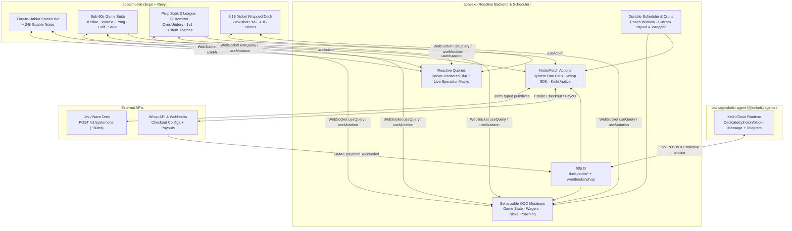

# Nickel — Deep Technical Specification & Integration Plan

**Event:** Y Combinator Consumer Mobile Hackathon (November 15, 2026 · 6:00 PM PST Submission · 7:00 PM Live Demos)  
**Team Hardware Constraint:** 2 Windows laptops + 1 MacBook (no local Xcode / Android Studio required)  
**Core Required Stack:** Capy · Revyl (`apps/mobile/.revyl/config.yaml`) · Convex (`convex@1.50.0`, `convex-test@0.0.71`)  
**Sponsor & Speed Stack:** Keiki (`@onkeiki/agents@0.1.7`) · Whop (`@whop/sdk@2.8.1`) · TypeSafe Jev (`@typesafe-ai/sdk@0.7.0`) / Nace Drex (`nace-sdk@0.8.0`)  
**Step-by-Step Execution & Revyl Testing Roadmap:** See [`PLAN.md`](./PLAN.md)

---

## Table of Contents

1. [System Overview & Core Product Loop](#1-system-overview--core-product-loop)
2. [Monorepo Architecture & File Ownership](#2-monorepo-architecture--file-ownership)
3. [Subsystem 1: Identity, Phone Binding & Group Onboarding](#3-subsystem-1-identity-phone-binding--group-onboarding)
4. [Subsystem 2: Convex Database Schema, Security & Retention Mechanics](#4-subsystem-2-convex-database-schema-security--retention-mechanics)
5. [Subsystem 3: Sub-60-Second Micro-Game Engines](#5-subsystem-3-sub-60-second-micro-game-engines)
6. [Subsystem 4: "Fantasy Anything" Custom Leagues & Kalshi-Style Prop Book](#6-subsystem-4-fantasy-anything-custom-leagues--kalshi-style-prop-book)
7. [Subsystem 5: TypeSafe Jev / Nace Drex (`systemOne`) Speed Layer](#7-subsystem-5-typesafe-jev--nace-drex-systemone-speed-layer)
8. [Subsystem 6: Keiki iMessage / SMS / Telegram Bridge](#8-subsystem-6-keiki-imessage--sms--telegram-bridge)
9. [Subsystem 7: Whop Financial Rails (Buy-Ins, Webhooks & Timed Payouts)](#9-subsystem-7-whop-financial-rails-buy-ins-webhooks--timed-payouts)
10. [Subsystem 8: "Nickel Wrapped" Engine & Instagram Stories Export](#10-subsystem-8-nickel-wrapped-engine--instagram-stories-export)
11. [Subsystem 9: Expo Mobile Client & Revyl Cloud Build Pipeline](#11-subsystem-9-expo-mobile-client--revyl-cloud-build-pipeline)
12. [Master Integration Plan, Contracts & Fallback Matrix](#12-master-integration-plan-contracts--fallback-matrix)

---

## 1. System Overview & Core Product Loop

**Nickel** turns an existing friend group chat into a **customizable Fantasy League + fast-play micro-game and wagering arena**.

1. **The Daily Nickel Economy:** Every player receives **+5 Daily Nickels** each day—held in an unclaimed jar that friends can **poach** in the final 2 hours of the day if the player hasn't completed their 30-second daily turn.
2. **Fast Native Micro-Games (<45s):** Players compete inside the Nickel mobile app across **One in a Krillion** (25s rarity trivia), **Wordle Blitz** (45s live color-masked race), **Cup Pong / Swish Hoops** (30s flick physics), **1-Hole Trick Mini-Golf** (25s slingshot physics), and **5x5 Blitz Salvo** (30s condensed Battleship).
3. **Kalshi-Style Group Wagers & Custom Fantasy:** Friends stake Nickels on head-to-head challenges, dynamic Over/Under prop lines on their friends, and custom fantasy themes (**Arcade Rotation**, **NHL/NBA/NFL**, or custom prompted leagues like **Fantasy AI Models**).
4. **Instagram/Spotify Behavioral Retention:** Top-of-app **Play-to-Unblur Avatar Rings** lock friends' answers, 24h Bubble Notes, and trash talk behind frosted glass until *you* play; finishing rips open a **variable-ratio Mystery Krill Pack**; and end-of-cycle settlement generates an interactive 9:16 **Nickel Wrapped** story deck shareable straight to Instagram Stories and iMessage while **Whop** pays out the real-money league pot on a customizable **Weekly / Bi-Weekly / Monthly** schedule.



---

## 2. Monorepo Architecture & File Ownership

Structuring the repository with strict directory boundaries lets 3 teammates (and parallel Capy subagents) merge continuously without git conflicts:

```text
consumerhackathon/
├── package.json                     # Bun workspaces root
├── DESIGN.md                        # Master architecture & integration spec
├── PLAN.md                          # Step-by-step execution & Revyl testing plan
├── convex/                          # [OWNER: Track A — Backend & AI]
│   ├── _generated/                  # Auto-generated typed API contracts
│   ├── schema.ts                    # Single source of truth DB schema + indexes
│   ├── auth.ts                      # Phone normalization + shadow-user merge
│   ├── leagues.ts                   # Create/customize league, H2H matchups, standings
│   ├── feed.ts                      # Play-to-Unblur Stories query + 24h Bubble Notes
│   ├── nickels.ts                   # Daily +5 stipend, OCC poaching, Mystery Pack roll
│   ├── games/
│   │   ├── krillion.ts              # 25s Dive action (System One) + collision mutation
│   │   ├── wordle.ts                # Server-only secret word + live color-mask mutation
│   │   ├── physics.ts               # Cup Pong & Trick Mini-Golf score/tiebreaker commit
│   │   └── salvo.ts                 # 5x5 Blitz Battleship grid generator & volley resolver
│   ├── wagers.ts                    # Over/Under prop market book, 1v1 duels, parlays
│   ├── wrapped.ts                   # Season stat aggregator + Archetype classifier
│   ├── seasons.ts                   # Custom timeline scheduler + season rollover
│   ├── whop.ts                      # Checkout session creator + Payout dispatcher
│   ├── keiki.ts                     # Outbound POST /agents/:id/notice helper
│   ├── lib/
│   │   └── systemOne.ts             # Unified Jev / Nace Drex client + fast fallback
│   ├── crons.ts                     # Daily round drop + poach window check
│   └── http.ts                      # POST /keiki/tools/* & POST /webhooks/whop
├── apps/
│   └── mobile/                      # [OWNER: Track B — Mobile UI, Games & Wrapped]
│       ├── .revyl/
│       │   ├── config.yaml          # Cloud Android APK & iOS Simulator build profiles
│       │   └── tests/               # Declarative Revyl YAML E2E regression tests
│       ├── .capyignore              # Keeps Revyl cloud upload archive lean (<100MB)
│       ├── app.json                 # Expo config (scheme: "nickel", permissions)
│       ├── package.json
│       ├── app/
│       │   ├── _layout.tsx          # ConvexProvider + Deep-link listener (nickel://)
│       │   ├── onboarding.tsx       # Phone + Name instant sign-in & shadow merge
│       │   ├── (tabs)/
│       │   │   ├── index.tsx        # Arena: Stories Bar + Daily Drop + Arcade Carousel
│       │   │   ├── wagers.tsx       # Kalshi-style Prop Cards + 1v1 Challenge Sheet
│       │   │   ├── league.tsx       # Standings, H2H Matchups, Whop Pot & Customizer
│       │   │   └── chat.tsx         # iMessage Link Code, Bounty Poke & Activity Feed
│       │   ├── games/
│       │   │   ├── krillion/[id].tsx
│       │   │   ├── wordle/[id].tsx
│       │   │   ├── pong/[id].tsx
│       │   │   ├── golf/[id].tsx
│       │   │   └── salvo/[id].tsx
│       │   ├── league/create.tsx    # Custom Fantasy Theme + Payout Timeline Wizard
│       │   └── wrapped/[id].tsx     # 5-Slide Reanimated Story Deck + IG Story Share
│       └── components/
│           ├── StoriesRingBar.tsx   # Play-to-Unblur rings + 24h Bubble Note popover
│           ├── MysteryPackModal.tsx # Swipe-to-rip variable-ratio reward reveal
│           └── PoachBanner.tsx      # Live countdown + 1-tap steal unclaimed Nickels
└── packages/
    └── keiki-agent/                 # [OWNER: Track C — Keiki Chat & Whop Flows]
        ├── package.json
        └── src/
            └── index.ts             # @onkeiki/agents kit.sync() config & tool schemas
```

---

## 3. Subsystem 1: Identity, Phone Binding & Group Onboarding

Group-chat products fail when chat users and mobile app users have disconnected IDs. Nickel unifies identity around **normalized E.164 phone numbers** (`+14085550199`) with optional `telegramUserId` support.

### 3.1 Phone Normalization Rule (`convex/auth.ts`)
Every phone input from mobile login or Keiki webhook context passes through one canonicalizer:
- Strip spaces, dashes, parentheses; if 10 digits (US default), prefix `+1`; if 11 digits starting with `1`, prefix `+`.

### 3.2 Three-Step Group Binding Flow
1. **App Side:** User A signs into the Expo app (`+14085550101`), taps **Create League**, picks a theme (e.g., *Fantasy AI Models* or *Arcade Mix*) and payout cadence (*Every 2 Weeks*), and gets `inviteCode = "KRILL5"`.
2. **iMessage / Telegram Side:** User A adds the Keiki agent's dedicated number to their group chat and sends:
   ```text
   @nickel link KRILL5
   ```
3. **Convex Binding + Shadow Provisioning:**
   - Keiki invokes `POST https://<deployment>.convex.site/keiki/tools/link_league` with headers `X-Keiki-Secret` and JSON body `{ args: { inviteCode: "KRILL5" }, context: { conversationId: "imsg:chat:8f92a...", phone: "+14085550101" } }`.
   - Convex sets `leagues.keikiConversationId = "imsg:chat:8f92a..."`.
   - Whenever **any other friend** in that group chat (`+16505550199`) texts `@nickel` or gets challenged before installing the app, `getOrCreateUserByPhone("+16505550199")` creates a `users` row (`isShadow: true`) and a `memberships` row with `nickelBalance: 5`.
   - When that friend downloads the Nickel app and enters `+16505550199`, `auth.signInWithPhone` flips `isShadow: false`, updates their display name/avatar, and preserves 100% of their bets, Nickels, and game history.

---

## 4. Subsystem 2: Convex Database Schema, Security & Retention Mechanics

### 4.1 Complete `convex/schema.ts`

```ts
import { defineSchema, defineTable } from "convex/server";
import { v } from "convex/values";

export default defineSchema({
  users: defineTable({
    name: v.string(),
    handle: v.string(),
    phone: v.string(),                      // Canonical E.164 (+1...)
    telegramId: v.optional(v.string()),
    avatarColor: v.string(),
    isShadow: v.boolean(),
    whopUserId: v.optional(v.string()),
    createdAt: v.number(),
  })
    .index("by_phone", ["phone"])
    .index("by_telegram", ["telegramId"]),

  leagues: defineTable({
    name: v.string(),
    inviteCode: v.string(),
    keikiConversationId: v.optional(v.string()),
    commissionerId: v.id("users"),
    themeType: v.union(
      v.literal("arcade_mix"),
      v.literal("hockey"),
      v.literal("basketball"),
      v.literal("football"),
      v.literal("ai_models"),
      v.literal("custom")
    ),
    customThemePrompt: v.optional(v.string()),
    cadence: v.union(
      v.literal("demo_blitz"),              // 3-minute cycle for live stage judging
      v.literal("weekly"),                  // 7 days
      v.literal("biweekly"),                // 14 days
      v.literal("monthly"),                 // 30 days
      v.literal("custom_days")
    ),
    cadenceDays: v.number(),
    buyInCents: v.number(),                 // e.g., 500 ($5.00)
    potBalanceCents: v.number(),
    payoutSplit: v.array(v.number()),       // Default [70, 30]
    dailyNickelAllowance: v.number(),       // Default 5
    enabledGames: v.array(v.string()),
    seasonNumber: v.number(),
    seasonStartsAt: v.number(),
    seasonEndsAt: v.number(),
    activeSettlementJobId: v.optional(v.id("_scheduled_functions")),
    squadStreakDays: v.number(),            // Consecutive days 100% of members played
    squadMultiplier: v.number(),            // 1.0 -> 2.0x boost
  })
    .index("by_invite_code", ["inviteCode"])
    .index("by_keiki_conv", ["keikiConversationId"]),

  memberships: defineTable({
    leagueId: v.id("leagues"),
    userId: v.id("users"),
    role: v.union(v.literal("commissioner"), v.literal("player")),
    nickelBalance: v.number(),
    unclaimedDailyNickels: v.number(),      // 5 at morning reset; moves to nickelBalance on play
    poachable: v.boolean(),                 // Flips true during final 2h window if unplayed
    seasonFantasyPoints: v.number(),
    weeklyMatchupPoints: v.number(),
    currentOpponentUserId: v.optional(v.id("users")),
    wins: v.number(),
    losses: v.number(),
    krillionCount: v.number(),
    poachedNickelsTotal: v.number(),
    timesPoached: v.number(),
    statusNote: v.optional(v.string()),     // 40-char 24h Instagram-Notes bubble
    reactionEmoji: v.optional(v.string()),
    statusUpdatedAt: v.optional(v.number()),
    powerups: v.array(v.string()),          // ["double_down", "bet_shield"]
    buyInPaid: v.boolean(),
    lastPlayedRoundId: v.optional(v.id("rounds")),
  })
    .index("by_league", ["leagueId"])
    .index("by_league_user", ["leagueId", "userId"])
    .index("by_league_points", ["leagueId", "seasonFantasyPoints"])
    .index("by_user", ["userId"]),

  rounds: defineTable({
    leagueId: v.id("leagues"),
    seasonNumber: v.number(),
    dateKey: v.string(),                    // "2026-11-15"
    isDailyMain: v.boolean(),               // True for the daily Play-to-Unblur gate round
    gameType: v.union(
      v.literal("krillion"),
      v.literal("wordle"),
      v.literal("cup_pong"),
      v.literal("mini_golf"),
      v.literal("salvo")
    ),
    title: v.string(),
    publicConfig: v.any(),                  // Category prompt, obstacle seed, par, shot count
    secretServerState: v.optional(v.any()), // Wordle target word or 5x5 Salvo ship coordinates
    challengerId: v.optional(v.id("users")),
    opponentId: v.optional(v.id("users")),
    stakeNickels: v.number(),
    status: v.union(v.literal("open"), v.literal("poach_window"), v.literal("settled")),
    startsAt: v.number(),
    poachOpensAt: v.number(),
    expiresAt: v.number(),
  })
    .index("by_league_status", ["leagueId", "status"])
    .index("by_league_date", ["leagueId", "dateKey"]),

  plays: defineTable({
    roundId: v.id("rounds"),
    leagueId: v.id("leagues"),
    seasonNumber: v.number(),
    userId: v.id("users"),
    status: v.union(v.literal("in_progress"), v.literal("completed")),
    publicSpectatorState: v.any(),          // Safe to stream before viewer plays (e.g. color masks)
    privateResult: v.optional(v.any()),     // Redacted by feed.ts until viewer completes round!
    normalizedAnswer: v.optional(v.string()), // Used for Krillion duplicate-answer collision check
    tierLabel: v.optional(v.string()),
    basePoints: v.number(),
    finalPoints: v.number(),                // After squadMultiplier / collision split
    tiebreakerMetric: v.number(),           // Duration ms or distance-to-pin mm
    mysteryReward: v.optional(v.object({
      nickels: v.number(),
      powerup: v.optional(v.string()),
      rarity: v.union(v.literal("common"), v.literal("rare"), v.literal("golden_krill")),
      opened: v.boolean(),
    })),
    startedAt: v.number(),
    completedAt: v.optional(v.number()),
  })
    .index("by_round", ["roundId"])
    .index("by_round_user", ["roundId", "userId"])
    .index("by_league_season", ["leagueId", "seasonNumber"]),

  wagers: defineTable({
    leagueId: v.id("leagues"),
    seasonNumber: v.number(),
    roundId: v.optional(v.id("rounds")),
    creatorId: v.id("users"),
    targetUserId: v.optional(v.id("users")), // Whose performance is being bet on
    takerId: v.optional(v.id("users")),      // Null if house/pool prop line
    wagerType: v.union(v.literal("over_under"), v.literal("h2h_challenge"), v.literal("krillion_parlay")),
    marketLabel: v.string(),
    metric: v.string(),                      // "points" | "wordle_guesses" | "pong_cups" | "golf_strokes"
    lineValue: v.number(),                   // e.g. 55.5 points or 3.5 guesses
    pickSide: v.union(v.literal("over"), v.literal("under"), v.literal("challenger")),
    parlayLegs: v.optional(v.array(v.object({
      targetUserId: v.id("users"),
      minPoints: v.number(),
      hit: v.optional(v.boolean()),
    }))),
    stakeNickels: v.number(),
    payoutMultiplier: v.number(),            // 1.9x standard, 2.0x w/ double_down, 8.0x 3-leg parlay
    usedShield: v.boolean(),
    status: v.union(v.literal("open"), v.literal("locked"), v.literal("won"), v.literal("lost"), v.literal("push")),
    createdAt: v.number(),
    settledAt: v.optional(v.number()),
  })
    .index("by_league_status", ["leagueId", "status"])
    .index("by_round", ["roundId"])
    .index("by_league_season", ["leagueId", "seasonNumber"]),

  wrappedSnapshots: defineTable({
    leagueId: v.id("leagues"),
    seasonNumber: v.number(),
    generatedAt: v.number(),
    totalNickelsWagered: v.number(),
    totalGamesPlayed: v.number(),
    potPaidCents: v.number(),
    winnerUserIds: v.array(v.id("users")),
    superlatives: v.object({
      biggestHater: v.object({ userId: v.id("users"), targetId: v.id("users"), fades: v.number(), netNickels: v.number() }),
      deepestBrain: v.object({ userId: v.id("users"), bestAnswer: v.string(), krillions: v.number() }),
      nickelBandit: v.object({ userId: v.id("users"), stolenNickels: v.number() }),
      clutchGod: v.object({ userId: v.id("users"), avgPoints: v.number() }),
    }),
    playerCards: v.array(v.object({
      userId: v.id("users"),
      rank: v.number(),
      seasonPoints: v.number(),
      archetypeTitle: v.string(),           // Assigned by System One
      archetypeTagline: v.string(),
      winRatePct: v.number(),
      payoutCents: v.number(),
    })),
  }).index("by_league_season", ["leagueId", "seasonNumber"]),

  transactions: defineTable({
    leagueId: v.id("leagues"),
    seasonNumber: v.number(),
    userId: v.id("users"),
    counterpartyUserId: v.optional(v.id("users")),
    kind: v.union(
      v.literal("whop_buy_in"),
      v.literal("whop_payout"),
      v.literal("daily_claim"),
      v.literal("poach_steal"),
      v.literal("mystery_pack"),
      v.literal("wager_stake"),
      v.literal("wager_win")
    ),
    amountCents: v.optional(v.number()),
    amountNickels: v.optional(v.number()),
    whopPaymentId: v.optional(v.string()),
    note: v.string(),
    createdAt: v.number(),
  })
    .index("by_league_season", ["leagueId", "seasonNumber"])
    .index("by_whop_payment", ["whopPaymentId"]),
});
```

### 4.2 Server-Enforced Retention Mechanics

1. **Play-to-Unblur Query (`convex/feed.ts -> getStoriesFeed`):**
   - Look up caller's `plays` row for the active `isDailyMain: true` round.
   - `const callerUnlocked = callerPlay?.status === "completed"`.
   - Map over every league member:
     - If `callerUnlocked === false` and `member.userId !== callerUserId`: return `{ userId, name, hasPlayed, publicSpectatorState, isBlurred: true, privateResult: null, statusNote: null, tierLabel: "Locked" }`.
     - If `callerUnlocked === true`: return full `privateResult`, `statusNote`, `reactionEmoji`, `tierLabel`, and all wagers placed against the caller.
   - Because Convex queries are reactive, completing your daily 25s round automatically pushes the unblurred Stories feed over WebSocket in `<50ms` with zero manual refetch.
2. **Serializable OCC Nickel Poaching (`convex/nickels.ts -> poachUnclaimedNickels`):**
   - At `round.poachOpensAt` (2 hours before daily reset, or triggered instantly via a Demo button), `internal.nickels.openPoachWindow` sets `poachable: true` for every member with `unclaimedDailyNickels > 0` and fires a Keiki group notice.
   - `poachUnclaimedNickels({ leagueId, thiefUserId, victimUserId })` runs inside a single Convex mutation:
     - Asserts `victimMembership.poachable === true && victimMembership.unclaimedDailyNickels > 0`.
     - Atomically sets `victimMembership.unclaimedDailyNickels = 0`, `victimMembership.poachable = false`, `victimMembership.timesPoached += 1`.
     - Credits `thiefMembership.nickelBalance += stolenAmount` and `thiefMembership.poachedNickelsTotal += stolenAmount`.
     - Inserts a `poach_steal` row in `transactions` and schedules a Keiki roast notice.
   - Simultaneous taps by multiple friends are serialized by Convex OCC; second caller cleanly receives `{ ok: false, reason: "Already poached!" }`.
3. **Variable-Ratio Mystery Krill Pack (`rollMysteryPack`):**
   - Rolled server-side on `isDailyMain` completion:
     - `70%` Common: `+5 Base Nickels` (+2 bonus Nickels)
     - `20%` Rare: `+5 Base Nickels` + `double_down` chip (`2.0x` on next wager)
     - `9%` Epic: `+5 Base Nickels` + `bet_shield` (refunds next lost wager)
     - `1%` (*10% in Demo Mode!*): **Golden Krill** (`+50 Nickels` + automatic iMessage confetti blast)

---

## 5. Subsystem 3: Sub-60-Second Micro-Game Engines

Every game shares a single unified lifecycle (`startPlay` -> live `updateSpectatorProgress` -> `completePlay` -> auto-settle linked `wagers`):

### 5.1 *One in a Krillion* ("The Dive" — 25-Second Clock)
- **Prompt Generation:** Uses league theme (`arcade_mix` general categories like *"Countries with exactly 4 letters"*; `hockey` like *"NHL players who won the Conn Smythe"*; `ai_models` like *"Open-weight LLM families under 15B parameters"*).
- **Execution Flow:**
  1. Player taps **Start Dive** -> `startedAt = Date.now()`, 25.0s countdown begins.
  2. Player submits text -> `convex/games/krillion.ts` Action calls Jev/Nace `systemOne()` (~30ms) returning `{ valid: boolean, obscurityScore: 0..5 }`.
  3. **Group Collision Check (Mutation):** Normalize string (`lowercase`, strip articles/punctuation). Query `plays.by_round` for any other player with the identical `normalizedAnswer`. If a collision exists, **halve `finalPoints` on both plays** and notify iMessage (*"Collision! Sritej and Peyton both guessed 'Oman'—points split in half!"*).
  4. **Points & Ocean Depth Mapping:**
     - Invalid -> `0 pts` (`0m — Wipeout`)
     - `0` Plankton -> `10 pts` (`100m`)
     - `1` Too Clever -> `15 pts` (`150m`)
     - `2` Schooler -> `30 pts` (`300m`)
     - `3` Rare -> `60 pts` (`600m`)
     - `4` Deep Cut -> `85 pts` (`850m`)
     - `5` **One in a Krillion** -> `100 pts` (`1,000m`) + increments `krillionCount`!

### 5.2 *Wordle Blitz* (45-Second Race)
- **Server-Only Secret:** `rounds.secretServerState = { word: "CRISP" }`. Public query strips `secretServerState`.
- **Two-Pass Duplicate-Safe Tile Mask Evaluation:**
  - Pass 1 marks exact index matches `🟩` (`2`) and decrements remaining letter frequency counts.
  - Pass 2 marks present-but-misplaced letters `🟨` (`1`) only while remaining frequency > 0, else `⬛` (`0`).
- **Live Spectator Sync:** Every submitted row appends `"🟨⬛🟩⬛⬛"` to `plays.publicSpectatorState.masks`, so friends in the Arena see live tile colors flip without letters.
- **Scoring:** Solved on guess `g` (`1..6`) awards `(7 - g) * 15 + Math.max(0, 30 - Math.floor(elapsedSec))` points (`tiebreakerMetric = durationMs`).

### 5.3 *Cup Pong / Swish Hoops* (30-Second Flick Physics)
- **Client Physics (`react-native-svg` + `PanResponder` + `requestAnimationFrame` at 60fps):**
  - 5 balls, 30-second clock. Swipe release captures `(dx, dy, velocity)` -> maps to initial launch `(vx, vy)`.
  - Rim/lip collision uses restitution `e = 0.72` (subtle high-bounce ping-pong/carnival rim physics so soft arc shots drop clean while flat lasers rim out).
- **Scoring:** Each make = `15 pts * streakMultiplier` (`1.0x, 1.2x, 1.5x, 2.0x, 2.5x`), max `115 pts` for 5/5 perfect rack (`tiebreakerMetric = durationMs`).

### 5.4 *1-Hole Trick Mini-Golf* (25-Second Slingshot)
- **Deterministic Obstacle Seed:** `rounds.publicConfig = { walls: [...], cup: { x, y }, tee: { x, y }, maxStrokes: 5 }`.
- **Zero-Tie Guarantee:** Score = `Math.max(10, 100 - (strokes - 1) * 20)`. If neither player holes out—or both finish in 2 strokes—`tiebreakerMetric` records the exact minimum Euclidean distance in millimeters to cup center during ball roll, guaranteeing every 1v1 wager has a decisive winner.

### 5.5 *5x5 Blitz Salvo* (30-Second Condensed Battleship)
- **Hidden Grid:** Server places 3 ships (`length 3`, `length 2`, `length 1` = 6 total ship cells) on a 5x5 grid (`25 cells`) in `secretServerState`.
- **Single-Volley Speed:** Instead of slow alternating turns, each player selects **5 radar target cells** within 20 seconds and taps **Fire Salvo** (plus 2 bonus cells unlocked if any first-wave shot hits!).
- **Scoring:** `15 pts` per hit + `25 pts` bonus per completely sunk ship (`max 100 pts`).

---

## 6. Subsystem 4: "Fantasy Anything" Custom Leagues & Kalshi-Style Prop Book

### 6.1 Custom Fantasy Generator (`convex/leagues.ts`)
When `createLeague` runs with `themeType` + `customThemePrompt`:
1. **Preset Modes (`arcade_mix`, `hockey`, `basketball`, `football`, `ai_models`):** Instantly seeds curated prompt banks and daily prop templates (e.g., for `ai_models`: *"Which lab tops Coding Arena this week?"* + AI-themed *One in a Krillion* prompts; for `hockey`: *"NHL Goalie / Stanley Cup Krillion"* + nightly puck-line pick'ems).
2. **Custom Prompt Mode (`custom`):** Commissioner types *any* niche (e.g., `"Formula 1 pit-stop degens"` or `"UC Berkeley EECS survival"`). Convex generates 7 days of themed *One in a Krillion* category prompts and custom prop markets stored on the league so rounds start with zero latency.
3. **Weekly / Cycle H2H Pairing:** Round-robin pairs `memberships` (`currentOpponentUserId`) so every player has a direct Sleeper-style head-to-head matchup running alongside the overall Season Leaderboard.

### 6.2 Kalshi-Style Wager Book (`convex/wagers.ts`)
- **Pre-Play Over/Under Markets:** Before Player B completes today's round, Player A sees a live prop card:
  - `Peyton — Today's Krillion Score: Over 55.5 (1.9x) / Under 55.5 (1.9x)`
  - Stake `1–20 Nickels` (optionally attach `double_down` for `2.8x` payout or `bet_shield` for 100% loss refund).
- **Locking Rule (Anti-Front-Running):** The millisecond Player B calls `startPlay`, Convex sets all open wagers with `targetUserId === playerB` to `status: "locked"` so nobody can bet on Peyton *after* watching Peyton sink 3 Cup Pong shots!
- **Atomic Auto-Settlement:** Inside `completePlay`, Convex queries `wagers.by_round`, compares Player B's `finalPoints` against `lineValue`, credits winning bettors' `nickelBalance` + `seasonFantasyPoints`, refunds shielded losses, and emits live toast + iMessage settlement alerts.

---

## 7. Subsystem 5: TypeSafe Jev / Nace Drex (`systemOne`) Speed Layer

### 7.1 Unified Wire-Compatible Wrapper (`convex/lib/systemOne.ts`)
Nace Drex (`https://console.nace.ai/v1/systemone`) is wire-compatible with TypeSafe Jev (`@typesafe-ai/sdk`). We configure a strict **2,500ms timeout** + deterministic heuristic fallback so gameplay never blocks even on spotty venue Wi-Fi:

```ts
import { TypeSafeClient, choice, noul, score } from "@typesafe-ai/sdk";

export function getSystemOneClient() {
  const naceKey = process.env.NACE_API_KEY;
  const typesafeKey = process.env.TYPESAFE_API_KEY;
  if (!naceKey && !typesafeKey) return null;

  return new TypeSafeClient({
    apiKey: (naceKey ?? typesafeKey)!,
    baseURL: naceKey ? "https://console.nace.ai/v1" : undefined,
    timeoutMs: 2500,
  });
}
```

### 7.2 All Four System One Decision Contracts

| Call Site | Input `state` | Questions (`noul` / `choice` / `score`) | Typical Latency | Fallback if Key Missing / Offline |
| :--- | :--- | :--- | :---: | :--- |
| **`gradeKrillionDive`** | `{ theme, categoryPrompt, answer }` | `valid: noul(...)` + `obscurity: score(..., 6-tier rubric)` | **~30ms** | Curated dictionary of 200 answers per preset prompt w/ pre-scored rarity tiers |
| **`pricePlayerPropLine`** | `{ gameType, last5Scores, avgScore, streak }` | `expectedTier: score(..., ["<25", "35", "50", "65", "80+"])` | **~25ms** | Rolling mean of player's last 5 rounds rounded to `.5` (default `45.5`) |
| **`triageGroupChatTurn`** | `{ sender, text, recentMessages, openRound }` | `action: choice(silent/tapback/tool/reply)`, `tapback: choice`, `intent: choice` | **~35ms** | Regex prefix parser (`@nickel`, `bet`, `challenge`, `link`) |
| **`classifyWrappedArchetypes`** | `{ memberStatsArray }` | Per-player `archetype: choice(krill_whisperer / generational_hater / nickel_bandit / clutch_god / chalk_merchant)` | **~35ms** | Deterministic stat-threshold ranker |

---

## 8. Subsystem 6: Keiki iMessage / SMS / Telegram Bridge

### 8.1 Critical Channel Configuration
- **iMessage Line:** Provision a **dedicated `photon` or `blooio` line** in the Keiki dashboard and set `features.groupChats = true` (`linq` and shared pool lines return `group_chats_unsupported`).
- **Parallel Cross-OS Channel:** Enable Keiki's `telegram()` channel alongside iMessage—both share Keiki's group-chat context engine, giving Android/international teammates instant zero-wait group parity.
- **Surface Rule:** Keep iMessage group replies crisp (1–2 lines + deep link `nickel://round/<id>` + native tapbacks `react_to_message` + `effect: "confetti"`). Never attempt `card_app` URL cards in group chats (Keiki restricts interactive cards to 1:1 DMs).

### 8.2 Keiki Webhook Tool Endpoints (`convex/http.ts`)
All tools authenticate via `X-Keiki-Secret == process.env.KEIKI_WEBHOOK_SECRET`:

1. `POST /keiki/tools/link_league` — `{ inviteCode: string }` -> binds `keikiConversationId` to `leagues`, registers sender phone, replies with active pot, payout countdown, and deep link.
2. `POST /keiki/tools/drop_game` — `{ gameType?: string }` -> opens or returns today's round + `nickel://games/...` link.
3. `POST /keiki/tools/place_chat_wager` — `{ targetName: string, side: "over" | "under" | "h2h", nickels: number }` -> creates a real `wagers` row straight from iMessage text!
4. `POST /keiki/tools/poach_nickels` — `{ victimName?: string }` -> executes `poachUnclaimedNickels` right from iMessage if the evening poach window is open!
5. `POST /keiki/tools/league_standings` — `{}` -> returns formatted Top 5 standings, H2H matchups, and Whop pot size.
6. `POST /keiki/tools/buy_in_link` — `{}` -> mints a personalized Whop Apple Pay checkout URL for the sender.

### 8.3 Proactive Outbound Notices (`convex/keiki.ts`)
Whenever a major event settles in Convex (*One in a Krillion* 100-pt pull, Nickel Poach theft, 1v1 upset, Poach Window opening, or Season Wrapped drop), an internal action posts to Keiki:
```ts
export async function sendGroupNotice(keikiConversationId: string, eventInstruction: string) {
  if (!process.env.KEIKI_API_KEY || !process.env.KEIKI_AGENT_ID) return;
  await fetch(`https://onkeiki.com/api/v1/developer/agents/${process.env.KEIKI_AGENT_ID}/notice`, {
    method: "POST",
    headers: {
      Authorization: `Bearer ${process.env.KEIKI_API_KEY}`,
      "Content-Type": "application/json",
    },
    body: JSON.stringify({
      phone: keikiConversationId,
      text: `[NICKEL_EVENT] ${eventInstruction} Keep announcement under 22 words, punchy, and include relevant stats.`,
    }),
  });
}
```

---

## 9. Subsystem 7: Whop Financial Rails (Buy-Ins, Webhooks & Timed Payouts)

### 9.1 Buy-In Checkout Creation (`convex/whop.ts -> createBuyInSession`)
```ts
import { WhopClient } from "@whop/sdk";

export async function mintWhopCheckout(params: {
  leagueId: string;
  userId: string;
  amountCents: number;
  leagueName: string;
}) {
  const whop = new WhopClient({ token: process.env.WHOP_API_KEY! });
  const cfg = await whop.checkoutConfigurations.create({
    account_id: process.env.WHOP_PLATFORM_ACCOUNT_ID!,
    variant: {
      visibility: "visible",
      billing_type: "one_time",
      release_method: "buy_now",
      currency: "usd",
      initial_price: params.amountCents / 100,
    },
    metadata: {
      leagueId: params.leagueId,
      userId: params.userId,
      kind: "season_buy_in",
    },
    redirect_url: `nickel://league/${params.leagueId}?paid=1`,
  });
  return { checkoutId: cfg.id, checkoutUrl: cfg.purchase_url };
}
```

### 9.2 Webhook Verification (`convex/http.ts -> POST /webhooks/whop`)
- Read raw body `await request.text()`.
- Verify HMAC signature using `unwrapWebhook(rawBody, { headers: Object.fromEntries(request.headers), key: process.env.WHOP_WEBHOOK_SECRET! })`.
- On `payment.succeeded`:
  - Extract `paymentId = data.id`, `leagueId = data.metadata.leagueId`, `userId = data.metadata.userId`.
  - Run `internal.whop.recordVerifiedBuyIn`: query `transactions.by_whop_payment(paymentId)`—if already present, return `200 OK` (idempotent). Otherwise insert `whop_buy_in` transaction, set `memberships.buyInPaid = true`, add `amountCents` to `leagues.potBalanceCents`, and send a Keiki notice.

### 9.3 Custom Cadence Settlement & Payouts (`convex/seasons.ts`)
- When a league is created or rolled over, Convex schedules `ctx.scheduler.runAt(seasonEndsAt, internal.seasons.settleSeasonAndGenerateWrapped, { leagueId, seasonNumber })`:
  - `weekly` -> `+7 days` · `biweekly` -> `+14 days` · `monthly` -> `+30 days` · `custom_days` -> `+N days` · `demo_blitz` -> `+3 minutes` (plus manual **"Settle & Trigger Wrapped Now"** commissioner button for live stage demos!).
- Settlement atomically:
  1. Ranks `memberships` by `seasonFantasyPoints` (tiebroken by `wins`, then `krillionCount`).
  2. Splits `potBalanceCents` across `payoutSplit` (`[70, 30]` -> 70% 1st, 30% 2nd).
  3. Calls Whop transfer/payout action (and logs `whop_payout` ledger rows with claimable Whop Wallet receipt status).
  4. Writes the immutable `wrappedSnapshots` document for `seasonNumber`.
  5. Increments `seasonNumber + 1`, resets `seasonFantasyPoints = 0`, and schedules the next cycle!

---

## 10. Subsystem 8: "Nickel Wrapped" Engine & Instagram Stories Export

1. **Deterministic Stat Aggregation (`convex/wrapped.ts`):**
   - Aggregates all `plays`, `wagers`, and `transactions` for `(leagueId, seasonNumber)`.
   - Computes four signature group superlatives:
     - **Generational Hater:** Pair `(creatorId, targetUserId)` with most `"under"` / fade bets + net Nickel delta.
     - **Deepest Diver:** Highest `obscurity` pull + total *One in a Krillion* badges.
     - **Nickel Bandit:** Most unclaimed Nickels poached (`poachedNickelsTotal`).
     - **Clutch God:** Highest win rate in 1v1 duels & final-5-second plays.
   - Calls `classifyWrappedArchetypes` via System One (~35ms) to assign personalized titles & witty taglines to every member.
2. **Interactive 9:16 Mobile Deck (`apps/mobile/app/wrapped/[id].tsx`):**
   - 5 full-screen animated slides (`react-native-reanimated` spring transitions + segmented top progress bar + `expo-haptics` heavy impact on reveals):
     - **Slide 1:** *Season Pulse* — Total Nickels wagered, games played, Full-Squad Streak peak.
     - **Slide 2:** *Your Signature Game & Deepest Krillion Pull* (ocean depth visualization).
     - **Slide 3:** *Your Rivalries* — Who faded you most & who you farmed Nickels off.
     - **Slide 4:** *The Group Superlative Receipt* (styled thermal/neon receipt of the whole chat).
     - **Slide 5:** *Your Season Persona Card + Whop Cashout Podium*.
3. **One-Tap Instagram Stories & iMessage Share:**
   - Wraps Slide 4/5 in a clean `<View ref={cardRef} collapsable={false}>`.
   - `const uri = await captureRef(cardRef, { format: "png", quality: 1, width: 1080, height: 1920 })`.
   - `await Sharing.shareAsync(uri, { mimeType: "image/png", dialogTitle: "Share Nickel Wrapped" })` -> opens native iOS/Android share sheet directly to **Instagram Stories**, **Close Friends**, or **iMessage**.

---

## 11. Subsystem 9: Expo Mobile Client & Revyl Cloud Build Pipeline

### 11.1 Expo Package Matrix (Zero Custom Native Code Breakage)
Every package is supported out-of-the-box in **Expo Go** (instant QR scan on Windows + Mac) AND **Revyl Cloud Builds**:
- `expo`, `expo-router`, `expo-linking`, `expo-haptics`, `expo-linear-gradient`, `expo-sharing`, `expo-web-browser`, `expo-status-bar`
- `react-native-reanimated`, `react-native-gesture-handler`, `react-native-svg`, `react-native-view-shot`, `react-native-safe-area-context`
- `convex`

### 11.2 Two-Loop Development + Cloud Compilation Strategy
1. **Inner Loop (<1s Hot Reload on 2 Windows + 1 Mac):**
   - Run `bunx convex dev` + `bunx expo start --tunnel`.
   - All 3 teammates scan the QR code on physical iPhones/Androids—no local Xcode, CocoaPods, or Android SDK needed on any laptop.
2. **Outer Loop (Revyl Cloud Native Compilation & Cloud Phones):**
   - Capy triggers `tools.mobile.build` targeting `apps/mobile`:
     - **Android Installable `.apk`:** `["bun install", "bunx expo prebuild --platform android --clean", "cd android && ./gradlew assembleRelease"]` -> outputs `android/app/build/outputs/apk/release/app-release.apk` (installable directly onto any Android phone + Revyl cloud `Pixel 7`).
     - **iOS Simulator `.app`:** `["bun install", "bunx expo prebuild --platform ios --clean", "cd ios && pod install", "xcodebuild -workspace ios/*.xcworkspace -scheme Nickel -configuration Debug -sdk iphonesimulator -derivedDataPath ios/build"]` -> runs on Revyl's 12-core macOS 26.6 Xcode 27 cloud runner and installs directly onto Revyl's cloud **`iPhone 18 Pro`** via `tools.capy.phone` for automated deep-link, layout, and haptics/flow testing.

---

## 12. Master Integration Plan, Contracts & Fallback Matrix

### Phase-by-Phase Integration Sequence (Zero Blocked Teammates)

#### Step 1: Spine & Typed Contract Freeze (First 30 Minutes)
1. Initialize Bun workspace root + `convex/schema.ts` + seed script (`convex/seed.ts`).
2. Deploy dev Convex backend (`EXPO_PUBLIC_CONVEX_URL` + `CONVEX_SITE_URL`) and commit `convex/_generated/` so **Track B (Mobile)** and **Track C (Keiki/Whop)** import 100% real TypeScript types immediately.
3. Run `seedDemoLeague` mutation to populate a realistic 5-friend league (*"Hometown Degens"*, `$25.00` Whop pot, 4/5 friends already played today's *One in a Krillion* so Play-to-Unblur, Poaching, Prop Lines, and Wrapped are testable from minute 30!).

#### Step 2: Parallel Subsystem Build (Next 150 Minutes)
- **Track A (Backend + System One):** Implement `lib/systemOne.ts`, all 5 game mutations/actions (`krillion`, `wordle`, `physics`, `salvo`), `feed.ts` (Play-to-Unblur + Bubble Notes), `nickels.ts` (OCC Poaching + Mystery Rip-Pack), `wagers.ts`, and `wrapped.ts`.
- **Track B (Expo Mobile App):** Build dark-obsidian + electric-nickel-mint design system, `StoriesRingBar`, `MysteryPackModal`, the 4 playable sub-60s game screens, `league/create.tsx` Custom Fantasy + Timeline wizard, and `wrapped/[id].tsx` 9:16 story deck with `view-shot` export.
- **Track C (Keiki + Whop + Revyl):** Sync `@onkeiki/agents` config (`kit.sync()`) to dedicated `photon`/`blooio` line + Telegram bot, wire `convex/whop.ts` + `/webhooks/whop`, and run the first **Revyl** cloud Android `.apk` + iOS `iPhone 18 Pro` build early to confirm green native compilation well before 5:00 PM.

#### Step 3: End-to-End Stitch & Live Demo Controls (Next 60 Minutes)
Wire a hidden **"Judge Demo Drawer"** (triple-tap League header) with 4 instant stage triggers so you never wait on real-world clocks during a 90-second YC demo:
1. **Drop Fresh Daily Krillion Round** (locks Stories Rings to frosted blur + pushes live Keiki iMessage drop).
2. **Open Evening Poach Window Now** (unlocks AFK friend's 5 Nickels + pings iMessage so you can poach live on stage).
3. **Force Golden Krill Pack (100% Odds)** (guarantees the swipe-to-rip Mystery Pack explodes with +50 Nickels & iMessage confetti on stage).
4. **End Season & Drop Nickel Wrapped + Whop Payout** (settles pot, pushes Wrapped podium to iMessage, and launches the 9:16 Wrapped story slides -> 1-tap share to IG Stories).

### Environment Variables Matrix

| Variable | Lives In | Purpose |
| :--- | :--- | :--- |
| `EXPO_PUBLIC_CONVEX_URL` | `apps/mobile/.env` | WebSocket URL for live Convex queries/mutations |
| `NACE_API_KEY` *(or `TYPESAFE_API_KEY`)* | Convex Env | Sub-40ms `systemOne()` Krillion grading, prop pricing &Wrapped archetypes |
| `KEIKI_API_KEY` & `KEIKI_AGENT_ID` | Convex Env + `packages/keiki-agent` | Syncing agent tools & firing proactive `/notice` messages to iMessage/Telegram |
| `KEIKI_WEBHOOK_SECRET` | Convex Env | Authenticating inbound tool calls at `/keiki/tools/*` |
| `WHOP_API_KEY` & `WHOP_PLATFORM_ACCOUNT_ID` | Convex Env | Creating Apple Pay buy-in checkouts & dispatching season payouts |
| `WHOP_WEBHOOK_SECRET` | Convex Env | HMAC verification on `/webhooks/whop` via `unwrapWebhook` |

### Graceful Degradation & Demo Safety Matrix

| External Dependency | Failure Scenario at 7:00 PM | Built-In Graceful Fallback |
| :--- | :--- | :--- |
| **Nace / Jev API** | Venue Wi-Fi spike > 2.5s or missing key | `systemOne.ts` auto-falls back in 2.5s to deterministic lexical + curated rarity dictionary so *One in a Krillion* never hangs |
| **Keiki iMessage Line** | Carrier/Apple delay on dedicated line provisioning | Same Keiki agent runs simultaneously on Telegram group + in-app live Chat Sync feed |
| **Whop Sandbox / Bank Rails** | Instant bank payout requires KYC settlement window | Real Whop Checkout runs live via Apple Pay/test card; Demo Drawer also supports instant verified ledger payout receipt if bank transfer is pending |
| **Physical iOS Signing** | Mac has no Xcode / Apple Developer cert | Physical iPhones run live via `expo start --tunnel`, Android phones install standalone Revyl `.apk`, and cloud `iPhone 18 Pro` runs native `.app` on Revyl |
