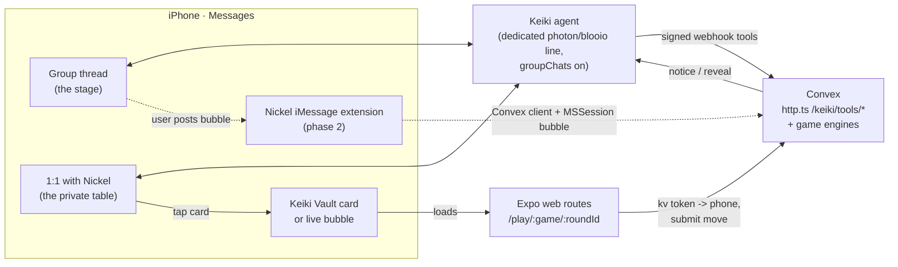

# Nickel × iMessage — Integration Research & Plan

Scope: everything a player sees or does **inside Messages**. Backend game logic (Convex) and the Expo app are owned elsewhere; this doc defines the contract they need to expose for iMessage to feel native.

Researched Nov 15, 2026 against Keiki's live docs and API (the Keiki org is connected through MCP; it has no agents or lines yet), Blooio and Photon docs, Apple's Messages framework, and the repo's `DESIGN.md`, `PLAN.md`, and `ideas.md` (on `abhi-main`).

---

## 1. TL;DR

1. **Keiki will not send app cards into group chats.** Cards (web pages that open inside Messages) only go to **1:1 chats on a dedicated line bought in Keiki**. Group chats get text, tapbacks, screen and bubble effects, threaded replies, images, and polls. That one fact decides most of the design.
2. So Nickel uses three iMessage surfaces, each for what it does best:
   - **The group thread is the stage.** The bot drops games, keeps score, reveals results, trash-talks, and runs the games that work fine in public: tic-tac-toe, Connect 4, emoji rebus races, polls.
   - **The 1:1 chat with Nickel is the private table.** Secret moves (Wordle guesses, Krillion answers, Battleship grids, Split or Steal, Lowest Unique Number) go here. Players either reply in text or tap a Keiki Vault card that opens the actual game UI inside Messages.
   - **Our own Nickel iMessage extension is a later phase.** It gives GamePigeon-style play in the group thread itself, built with `expo-targets` (`messages` type, React Native UI supported). It needs Apple signing, App Store or TestFlight distribution, and per-user installs, so it's not hackathon scope.
3. **The main loop is drop, whisper, reveal.** The bot drops a round in the group with a deep link. Each player taps it, which opens a prefilled 1:1 text to Nickel, so the player sends first and the line stays healthy. They play privately. The bot reveals everything at once in the group with effects and a result-card image. This is the commit-reveal anti-cheat rule from `ideas.md` turned into a UX pattern.
4. **Keiki Vault cards solve sign-in without codes.** Every card URL carries `#kv=<token>`. Our backend exchanges it at `POST /api/v1/developer/vault/principal` for the **provider-verified phone number** the card was sent to. That replaces the unverified "type your phone number" sign-in in `DESIGN.md` §3, which today lets anyone act as anyone.
5. **Write games once as Expo web routes.** One React Native codebase served on web (`/play/<game>/<roundId>`) works as the Vault card today, a live in-bubble card, a fallback link, and the later extension and App Clip. No separate web game codebase.

---

## 2. What the platform can actually do

Verified from docs or the live API unless marked **[verify]**.

| Capability | Group chat | 1:1 chat | Source / notes |
| :--- | :---: | :---: | :--- |
| Text replies, threaded replies | ✅ | ✅ | Keiki cloud-agents → iMessage |
| Tapbacks on a specific message | ✅ | ✅ | Agent sees every message id |
| Screen and bubble effects (confetti, fireworks, slam, …) | ✅ **[verify in group]** | ✅ | Docs say "every iMessage line" |
| Native iMessage polls (iOS 26+; older OS sees "Sent a poll") | ✅ **[verify via Keiki in group]** | ✅ | Instant and Standard lines |
| Image carousel (`cards` capability, `render_cards`, 4–6 slides become a swipeable stack) | ✅ | ✅ | Text fallback is automatic |
| Voice notes | ✅ | ✅ | Instant lines only |
| **App cards** (`send_widget` / tool `presentation`, HTTPS page in Messages) | ❌ | ✅ | Dedicated Keiki-bought line + Dynamic UI add-on |
| **Live app card** (`live: true`, the page renders *in the bubble*) | ❌ | ✅ | Vault only; the bubble doesn't scroll, so fit the page to it |
| Face ID approval card (`policy.approval: "ask"`) | ❌ | ✅ | Good fit for the Whop buy-in and big wagers |
| Custom extension bubbles (`card_app` → our own bundle id) | ❌ | ✅ | Template bubble only (`live` ignored); requires a DNS-verified domain |
| Contact card (name and photo for the line) | ❌ (per-group) | ✅ | Send early so links preview |

**Group-chat rules (Keiki):**
- Needs a **dedicated `photon` or `blooio` line** with `features.groupChats` on. `linq` lines and shared numbers ignore groups.
- The bot answers when someone **starts with its name**, uses **`@name`**, or **replies to one of its messages**. Within 5 minutes of its last reply, a small model decides whether follow-ups are meant for it. Everything else is stored quietly as context.
- Each group is one conversation (`imsg:chat:<id>`), and messages are labelled with **sender names**. Webhook tools receive the group id as `context.phone`. **[verify]** whether the sender's phone number reaches tools in a group. `DESIGN.md` §8.2 assumes it does.
- Identity-webhook-scoped tools **require DM evidence** and refuse private data in groups. Design the group tools to need only public data.

**Line health limits (these shape the UX):** fewer than 50 *new* conversations per line per day (hard cap 50 per UTC day), about 5,000 messages per line per day, no bursts, two-way traffic, and nothing at night. **Let users text first** (an `sms:` link with a prefilled body). Send no links or cards until the user has replied. Aim for about one user reply per two bot messages.

**Cost:** a dedicated iMessage line costs **$300/month** (from the live API, `getLinesPrice`). Plan on one line for the demo.

---

## 3. Architecture

- **Keiki** is the bot's voice and router. Its tools call Convex. It holds no game state.
- **Convex** owns all state, timers, scoring, and reveals. It gets the reveal into the group by triggering the bot's turn (§7).
- **The `/play` web routes** are the same Expo screens the app uses, exported for web.

---

## 4. Interaction patterns

### A. Drop, whisper, reveal (most games)
1. **Drop (group):** "🦐 *One in a Krillion* is live: *Countries with exactly 4 letters*. 25 seconds once you start. Tap to dive → [link]". The link is `sms:+1<line>&body=dive KRILL5-R42`.
2. **Whisper (1:1):** the player taps the link, Messages opens a 1:1 chat with Nickel, and the body is already typed, so the user starts the conversation. The bot answers with a **Vault card** (`/play/krillion/R42`) or, without Vault, plays in plain text ("Go. 25s. Reply with one answer.").
3. **Lock (group):** each submission gets a 👍 tapback on the drop message and a quiet "4/6 locked in" update by editing or threading, never a new message per player.
4. **Reveal (group):** when everyone has played or the cutoff hits, one message goes out: a `render_cards` carousel (podium, the rarest answer, collisions), a **slam** or **confetti** effect for a *One in a Krillion* pull, and one line of trash talk.

### B. Turn-based in public (tic-tac-toe, Connect 4, Battleship turns)
The board is an emoji grid in a threaded reply. Moves are "@nickel b2", or just "b2" while the 5-minute follow-up window is open. The bot re-renders the board in the same thread, so the main thread stays clean. Spectators watch for free, which suits these games.

### C. Live bubble (1:1, Vault `live: true`)
The page renders inside the transcript bubble. This works for **Stop the Clock**, the **Wordle** board, and the **Salvo** grid, with no expand step. Keep it to one screen with no vertical scroll.

### D. Native poll (group)
Use polls where public votes are fine: **Majority Rules**, **Over/Under** props ("Peyton over 3.5 Wordle guesses?"), and **group-picked punishment**. Votes arrive as poll events, and Convex scores them. **[verify]** that Keiki sends poll vote events to the agent or tools.

### E. Public race (group)
The bot posts a puzzle (an emoji rebus, an anagram, "first to name a 4-letter country"). The first correct reply wins and gets a ‼️ tapback plus a points line. This works best when the group is already chatting.

---

## 5. Game-by-game mapping

| Game | Surface | Input | Reveal | Notes |
| :--- | :--- | :--- | :--- | :--- |
| **Wordle Blitz** | 1:1 (Vault live card, or text guesses) | 5-letter guesses | Group: everyone's 🟩🟨⬛ grids in one carousel, solve times | Live color-only spectator strip in the group would mean many messages. Post only "Sritej solved in 3 🔥" lines, batched. |
| **One in a Krillion** | 1:1 text (one answer, so text is enough) | One free-text answer, 25s timer starts on the bot's "Go" | Group: depth podium, collisions ("Sritej and Peyton both said *Oman*, halved"), slam effect on a 100-pt pull | The best text-native game. No card needed. |
| **5x5 Salvo (Battleship)** | 1:1 Vault live card (grid), text fallback "a1 c3 e5 b2 d4" | 5 cells, then 2 bonus cells if any hit | Group: an image of each player's hit grid | Classic two-player Battleship can also run as an H2H thread: each side places ships in 1:1 and calls shots in the group thread. |
| **Tic-tac-toe / Connect 4** | Group thread (pattern B) | "b2" / "col 4" | Inline board; winner gets a tapback and an effect | Public by nature. Great for H2H side bets. |
| **Lowest Unique Number / ⅔ of the Average / Closest Estimate** | 1:1 text | One number | Group: a number-line image showing everyone's picks | One message per player. Ideal for drop, whisper, reveal. |
| **Stop the Clock** | 1:1 Vault live card | One tap | Group: "9.98s 🔥" leaderboard | Time it on the server (start and stop events reach Convex) to stop client-side cheating. |
| **Majority Rules / Minority Wins** | Group native poll | Vote | Poll result plus scoring line | Falls back to "reply A or B" in 1:1 on iOS older than 26. |
| **RPS / Penalty Kick / Odds or Evens** | 1:1 text | One word | Group: simultaneous reveal with "3… 2… 1…" in one message | H2H only. Tie the result to the weekly matchup. |
| **Split or Steal / Sealed Bid** | 1:1 text, plus a **Face ID approval card** when real Nickels are staked | split/steal, a bid | Group: the drama line with the slam effect | The best group-chat moment on the list. Save the effect for this. |
| **Cup Pong / Hoops / Mini-Golf** | 1:1 Vault card (expanded, physics needs room) | Swipe | Group: score and a replay GIF if cheap | Hardest on web. Keep these as app-first, with the bot posting results only. |
| **Emoji Rebus / Anagram race** *(new)* | Group thread (pattern E) | Free text | Instant tapback on the winner | Zero setup. A good opener while waiting on the daily drop. |
| **Connect 4** *(new)* | Group thread (pattern B) | Column number | Inline board | Same engine shape as tic-tac-toe. |

**Starting lineup for the demo:** One in a Krillion (text, the hero), Wordle (Vault live card), Lowest Unique Number (text, best reveal), tic-tac-toe (public H2H), Split or Steal (drama), and one native poll prop. This covers every pattern above.

---

## 6. Identity and onboarding

**Problem:** `auth.signInWithPhone` in `DESIGN.md` trusts whatever phone number is typed, and `poachUnclaimedNickels({ thiefUserId })` trusts a client-supplied id.

**Solution:**
- **Inside Messages:** every Vault card URL carries `#kv=<token>`. The page reads it from `location.hash` and posts it to Convex. Convex calls Keiki `POST /api/v1/developer/vault/principal` (API key with `people:read`) and gets back `{ phone, card_id, expires_at }`. That phone number is provider-verified. Convex then mints its own session. The token expires after 24 hours, and a forwarded bubble carries the same token, so sessions should start on the first lookup.
- **In 1:1 text:** Keiki-bought lines carry a provider-verified sender. Set an **identity webhook** (Convex `/keiki/identity`) that maps phone → `userId` and scopes, and put `policy.requiredScopes` on money tools (wagers, poach, buy-in). Never accept `userId`, `phone`, or `thiefUserId` as a tool argument. Derive the acting user from the signed context.
- **The Expo app:** sign in by tapping "Verify with iMessage". This opens `sms:` to the line with `body=login <nonce>`. The inbound message proves the user owns that number. Convex binds the nonce to the phone number, and the app polls the nonce. No SMS one-time code provider is needed.
- **Shadow users** (`isShadow: true`) keep working. Now they get created from verified senders only.

**Group binding** (refines `DESIGN.md` §3.2):
1. In the app: Create League → invite code `KRILL5`, and a share sheet with "Add Nickel to your group chat" that copies the line's contact card.
2. In the group: "@nickel link KRILL5" → the bot binds `imsg:chat:<id>` to the league and replies with the pot, the countdown, and a short how-to.
3. Each member's first tap on a drop link opens their 1:1 with Nickel. This creates their shadow user from a verified number and counts as user-initiated, so it doesn't use up the 50/day new-conversation budget.

---

## 7. Proactive messages: reveals, drops, poach windows

- `POST /agents/:id/notice` is **mediated by the model**: the agent reads the notice and *decides* whether and how to tell people. The doc's `sendGroupNotice(phone: keikiConversationId, …)` pattern relies on `phone` accepting a group id (`imsg:chat:…`). **[verify]** that, and the latency.
- Reveals are the moment that has to land, so make them **deterministic**. The notice includes the exact payload, and the agent's system prompt says: "On a `[NICKEL_REVEAL]` notice, call `render_reveal` and post it verbatim with the given effect." Check in Keiki's Eval Studio that it never paraphrases scores.
- **Budget:** about 3 bot messages per group per day by default (the drop, one mid-day nudge only if under half the group has played, the reveal). Poach windows and Golden Krill are extra. Nothing between 10pm and 8am in the group's timezone. Anything more risks a flagged line and muted groups.

---

## 8. Voice and message design rules

- One message, not three. Two lines maximum in the group. Put details in the carousel image, not in text.
- Use effects only for rare events (a 100-pt Krillion, Split or Steal betrayals, season payout). If every round gets confetti, it stops meaning anything.
- Use tapbacks as the default acknowledgement ("locked in" = 👍 on the player's message, a win = ‼️). They're silent and native, and they don't add messages.
- Use threads for anything multi-step (tic-tac-toe boards, wager negotiations), so the main thread only shows drops and reveals.
- Every link and card has a text fallback (SMS/RCS users on Android get plain text).
- The bot's name and contact card say **Nickel**. Members address it as "nickel …" or "@nickel".

---

## 9. Keiki tool contract (replaces `DESIGN.md` §8.2)

All tools are **signed webhook tools** to `CONVEX_SITE_URL/keiki/tools/*`. Convex verifies requests with `verifyWebhook` from `@onkeiki/agents/cloud` (HMAC with a five-minute window) instead of a static `X-Keiki-Secret` header. The acting user always comes from the signed context.

| Tool | Where | Does |
| :--- | :--- | :--- |
| `link_league({ inviteCode })` | group | Bind the group to the league |
| `drop_game({ gameType? })` | group | Open or return today's round. Returns the copy and the `sms:` whisper link |
| `join_round({ roundCode })` | 1:1 | Handles "dive KRILL5-R42". Starts the play, returns a `presentation: { type: "app", live, url: "/play/…" }` or text instructions |
| `submit_move({ roundCode, move })` | 1:1 | Text-mode answer, guess, cell, or number |
| `board_move({ gameId, move })` | group | Public turn-based moves |
| `create_prop({ … })` / poll results | group | Native poll props |
| `place_wager({ … })` | 1:1 | `policy.approval: "ask"` → Face ID card |
| `poach({ victimName? })` | 1:1 | Acting user from context |
| `standings({})` | both | Top 5, H2H, pot |
| `render_reveal({ roundId })` | group | Returns the slides for `render_cards` plus the effect name |
| `buy_in({})` | 1:1 | Whop checkout link (opens outside Messages; Vault cards keep only same-origin pages inside) |

Keiki setup: one agent, a dedicated `blooio` or `photon` line, `features.groupChats` on, the **Dynamic UI** add-on on, the `cards` capability installed, an identity webhook, and a contact card named **Nickel**. Put the line, agent, and capabilities in the repo using `kit.sync()` from `packages/keiki-agent` (channels are still provisioned in the dashboard; `sync` doesn't forward `channels`).

---

## 10. Phase 2: our own iMessage extension and App Clip

- **What it gets us:** play *inside the group thread* with one bubble per game that updates in place (`MSSession`), live layouts, and no 1:1 detour. It's the GamePigeon experience.
- **How:** `expo-targets` with a `messages` target and RN UI. It shares an App Group with the main app for the Convex session. It reuses the same `/play` screens.
- **Bot bridge:** Blooio delivers inbound custom bubbles as `message_type: "imessage_app"` with our `url` state and a `session_id`. **[verify]** that Keiki forwards these to the agent. If it does, the bot can react to and score bubbles posted in the group.
- **Keiki `card_app`:** point 1:1 cards at our extension (`team_id`, `extension_bundle_id`, `app_store_id`, DNS-verified `url_hosts`). The catch: custom cards are template bubbles (no `live`), and recipients without the extension get an App Store prompt.
- **App Clip** for zero-install play from a link (Blooio's `app_clip` content type).
- **Blockers:** an Apple Developer account and signing, App Review, and every friend installing the app. Extension participant ids are anonymous per conversation and are **not** phone numbers, so identity must come from the app's session. `PLAN.md` says there's no Xcode or Apple cert on the team, so this is post-hackathon.

---

## 11. Hackathon build order (iMessage track)

1. Keiki: create the agent, buy one dedicated line, turn on group chats, Dynamic UI, `cards`, and the contact card. Text the line from 3 phones and make a test group.
2. Convex: `/keiki/tools/*` with `verifyWebhook`, the identity webhook, and `vault/principal` exchange for `/play` sessions.
3. Text-only games end to end: Krillion, Lowest Unique Number, and tic-tac-toe in a thread. This is the demo's safety net. It works with no installs.
4. `/play/wordle` and `/play/clock` as Expo web routes behind Vault live cards.
5. Reveal carousel template and the effects policy.
6. Native poll prop and Split or Steal with a Face ID approval.
7. Run Eval Studio cases on the group-chat transcripts ("@nickel link", a drop, 6 players whispering, a reveal) before the demo.

---

## 12. Open questions to verify on a real line

1. Do effects and native polls go out in **group** chats through Keiki, and do poll votes reach tools?
2. Does a group webhook tool get the **sender's phone** (or only `imsg:chat:<id>` plus a display name)?
3. Does `/notice` accept a group conversation id as `phone`, and how fast does a reveal land?
4. Does Keiki forward inbound `imessage_app` bubbles (from another app or our future extension) to the agent?
5. Which line type (`photon` or `blooio`) is both "Instant" (voice notes, effects, cards) **and** group-capable for us?

---

## Sources

- Keiki: [iMessage Apps](https://onkeiki.com/docs/imessage-apps), [Keiki Vault](https://onkeiki.com/docs/keiki-vault), [Cloud agents: iMessage and group chats](https://onkeiki.com/docs/cloud-agents), [Channels compared](https://onkeiki.com/docs/channels), [Rich cards](https://onkeiki.com/docs/cards), [Conversation auth](https://onkeiki.com/docs/conversation-auth), [Identity](https://onkeiki.com/docs/identity), [iMessage best practices](https://onkeiki.com/docs/imessage-best-practices), [iMessage apps vs bots](https://onkeiki.com/blog/imessage-apps-vs-imessage-bots); live API: `getLinesPrice`, `putAgentsCardApp` schema, marketplace `cards` capability.
- Blooio: [Custom bubbles](https://docs.blooio.com/guides/custom-bubbles). Photon: [native polls](https://photon.codes/docs/spectrum-ts/providers/imessage/messaging-features/native-polls).
- Apple: [MSMessagesAppViewController](https://developer.apple.com/documentation/messages/msmessagesappviewcontroller), [IceCreamBuilder sample](https://developer.apple.com/documentation/messages/icecreambuilder-building-an-imessage-extension).
- [expo-targets](https://github.com/csark0812/expo-targets) (`messages` target, RN UI).
