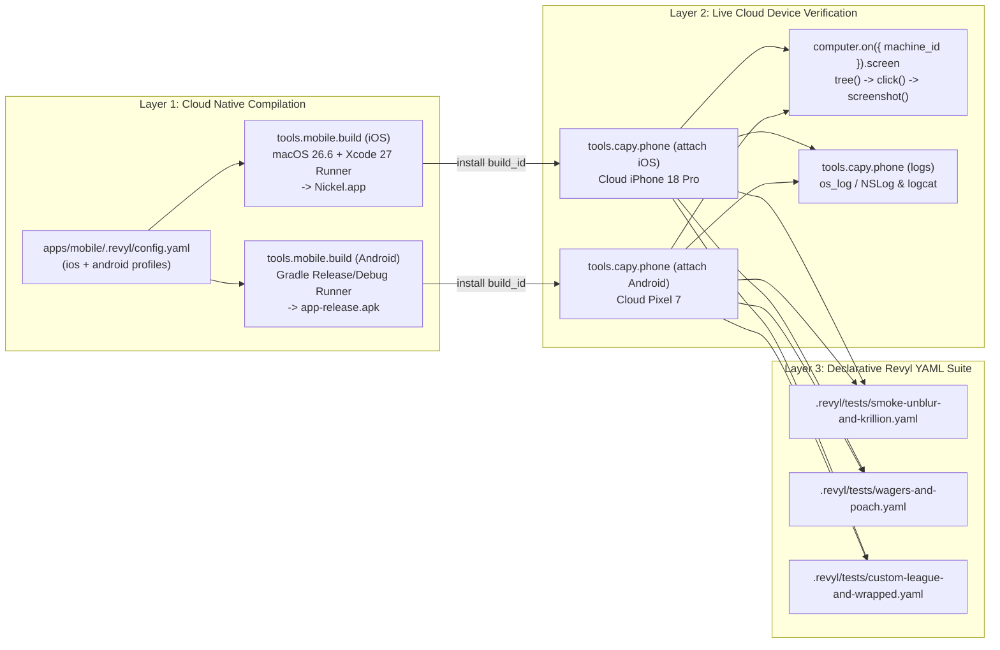

# Nickel — Step-by-Step Execution & Revyl Testing Plan (`sritej/main`)

**Branch:** `sritej/main`  
**Verified Package Versions (live on npm as of Nov 15, 2026):**
- `convex@1.50.0` + `convex-test@0.0.71` + `vitest` (in-memory backend unit & OCC concurrency testing)
- `expo@58.0.25` + `expo-router` + `expo-dev-client` (required for Revyl Android/iOS Dev Loop + deep links)
- `@typesafe-ai/sdk@0.7.0` / `nace-sdk@0.8.0` (`TypeSafeClient` / `NaceClient` -> `systemOne()`, `choice`, `noul`, `score`, `image` / `imageInput`)
- `@onkeiki/agents@0.1.7` (`AgentKit.create`, `defineTool`, `kit.sync()`, `kit.handleInbound()` for programmatic testing, `ChannelEnvelope` with `provider: 'photon' | 'blooio'`)
- `@whop/sdk@2.8.1` (`new WhopClient({ token, apiVersionDate: "2026-11-13-1" })`, `client.checkoutConfigurations.create`, `client.accountLinks.create`, `client.payouts.create` / `transfers`)

---

## 1. Key Findings from Deep Technical Research

### 1.1 Revyl Build & Device Testing Architecture (Two Complementary Loops)
Our research into `docs.revyl.com` and Capy's native Revyl tools uncovered two ways to build, drive, and regression-test **Nickel** on cloud iOS and Android devices without local Xcode or Android Studio:

1. **Capy Native Revyl Tooling (`tools.mobile.build` + `tools.capy.phone` + `tools.capy.computer`):**
   - **Remote Compilation (`tools.mobile.build`):** Archives `apps/mobile` (`type: "workspace"`, max 100 MB excluding `node_modules`, `.git`, `.expo`, and `.capyignore`) and runs our build commands on Revyl's cloud runners:
     - **iOS Cloud Runner:** Clean **macOS 26.6.2 arm64** (12 cores, ~98 GB free disk) with **Xcode 27.0**, iOS Simulator runtimes `18.5`, `26.2`, `26.5`, and `27.0`, Node 22, and CocoaPods. Produces an `.app` bundle (`ios/build/Build/Products/Debug-iphonesimulator/Nickel.app` or `Release-iphonesimulator/Nickel.app`).
     - **Android Cloud Runner:** Runs `bunx expo prebuild --platform android` + `./gradlew assembleRelease` (or `assembleDebug`) to produce an installable `.apk` (`android/app/build/outputs/apk/release/app-release.apk`).
   - **Cloud Device Attachment (`tools.capy.phone`):**
     - `action: "attach"` provisions a cloud **iPhone 18 Pro** (or **iPhone Duo** foldable / **iPhone 16** / **Pixel 7**) directly in this thread.
     - `action: "install"` with `build_id` installs the compiled artifact into the running session (preserving app data across hot updates).
     - `action: "open_url"` tests our `nickel://round/<id>` and `nickel://league/<id>?paid=1` deep links directly as if tapped from iMessage.
     - `action: "logs"` streams `os_log` / `NSLog` on iOS and `logcat` on Android to catch any runtime error immediately.
   - **Interactive Screen Driving (`tools.capy.computer.on({ machine_id })`):**
     - Follows the **Observe -> Act -> Verify** loop (`await phoneScreen.tree()`, `await phoneScreen.click("Start Dive").wait(500).screenshot()`), allowing automated visual + accessibility-tree verification of every screen and game on a real cloud iPhone and Pixel.

2. **Revyl CLI & Declarative YAML Test Suite (`apps/mobile/.revyl/config.yaml` + `.revyl/tests/*.yaml`):**
   - **Crucial Monorepo Rule (`docs.revyl.com/frameworks/expo`):** In a monorepo, `.revyl/config.yaml` and `revyl init` / `revyl build` belong inside `apps/mobile/` (the Expo app folder), **not** the repository root.
   - **Custom URL Scheme Requirement:** `app.json` **must** define `"scheme": "nickel"` *before* the first native prebuild so the scheme is baked into `Info.plist` (`CFBundleURLSchemes`) and `AndroidManifest.xml` and recorded in Revyl's artifact metadata.
   - **Declarative YAML E2E Tests (`.revyl/tests/*.yaml`):** Revyl executes multi-step tests (`instructions`, `validation`, `extraction`, `if`, `manual`) against any uploaded `build_version_id` and produces screenshot + step-verdict reports (`revyl test run <name> --build-id <id>`).

---

### 1.2 Verified SDK Signatures & Gotchas

| SDK | Exact Verified Pattern | Critical Gotcha Discovered in `.d.ts` / Docs |
| :--- | :--- | :--- |
| **`@typesafe-ai/sdk@0.7.0` & `nace-sdk@0.8.0`** | `const client = new NaceClient({ apiKey })` or `new TypeSafeClient({ apiKey, baseURL })`; `await client.systemOne({ state, questions: { valid: noul(...), rarity: score(...) } })` | `nace-sdk` defaults to `https://console.nace.ai` and `drex-latest` with a 60s timeout and returns `evaluation_time_ms` + `answers`. For photo dares, `nace-sdk` uses `images: [imageInput(bytes)]` on `drex-max-v1.1`, whereas `@typesafe-ai/sdk` requires header `{"TypeSafe-Danger-Zone-Images": "true"}`. |
| **`@onkeiki/agents@0.1.7`** | `defineTool({ name, description, input: Schema.Struct({...}), execute: (input, ctx) => Effect.gen(...) })` inside `AgentKit.create({ apiKey, name, agent: { model, systemPrompt, tools } })` | `kit.handleInbound(msg)` is built into `AgentKitInstance`! That means we can unit-test our Keiki agent's tool calls and iMessage responses locally in Vitest *before* even binding a live phone line. Also, `ctx.channel?.provider` tells us `'photon' \| 'blooio'` and `ctx.channel?.isDirect` tells us DM vs. group chat! |
| **`@whop/sdk@2.8.1`** | `new WhopClient({ token: process.env.WHOP_API_KEY!, apiVersionDate: "2026-11-13-1" })` | The Whop SDK **does not auto-read `process.env.WHOP_API_KEY`**—omitting `token` silently sends unauthenticated requests that 401! Always pass `token` explicitly and pass `idempotencyKey` on mutations. |
| **`convex@1.50.0` + `convex-test@0.0.71`** | `const t = convexTest(schema); await t.mutation(api.nickels.poachUnclaimedNickels, ...); await t.finishInProgressScheduledFunctions();` | Cron jobs in `convex/crons.ts` **must** target `internal.*` functions, never public `api.*` functions. All seed functions (`convex/seed.ts`) should be idempotent `internalMutation`s. |

---

## 2. Step-by-Step Execution Plan (8 Gated Milestones)

Every step below has a **concrete deliverable** and an **automated verification gate** before moving to the next step.

---

### Step 1: Monorepo Bootstrap & Convex Schema + In-Memory Test Harness
**Goal:** Stand up the workspace, Convex schema, and `convex-test` suite so all backend logic is verified deterministically in <2 seconds.

1. **Workspace Setup:**
   - Create root `package.json` with workspaces `["convex", "apps/mobile", "packages/keiki-agent"]`.
   - Install `convex@1.50.0`, `convex-test@0.0.71`, `vitest`, `@edge-runtime/vm`, `@typesafe-ai/sdk@0.7.0`, `nace-sdk@0.8.0`, `@whop/sdk@2.8.1`.
2. **Schema & Seed (`convex/schema.ts`, `convex/seed.ts`):**
   - Implement the 8 tables (`users`, `leagues`, `memberships`, `rounds`, `plays`, `wagers`, `wrappedSnapshots`, `transactions`) with all compound indexes (`by_invite_code`, `by_keiki_conv`, `by_league_user`, `by_league_points`, `by_round_user`, `by_whop_payment`).
   - Write idempotent `seedDemoLeague` mutation creating `"Hometown Degens"` (`inviteCode: "KRILL5"`, `$25.00` pot, 5 members: Sritej, Peyton, Alex, Maya, Jordan) + a second custom league `"Fantasy AI Lab"` (`inviteCode: "AIMOD5"`, `themeType: "ai_models"`).
3. **Verification Gate 1:**
   - Run `bunx vitest run convex/schema.test.ts` using `convexTest(schema)` to verify `seedDemoLeague` populates all tables cleanly and idempotently.

---

### Step 2: Retention Psychology Engine & Game State Machines in Convex
**Goal:** Build and unit-test Play-to-Unblur, OCC Nickel Poaching, Mystery Krill Rip-Packs, and all 5 sub-60-second games.

1. **Retention & Social Layer (`convex/feed.ts`, `convex/nickels.ts`):**
   - `getStoriesFeed`: Redacts `privateResult`, `statusNote`, and `tierLabel` for other members while the caller's daily main play is incomplete; unblurs automatically upon completion.
   - `postStatusNote`: Saves 40-char 24h Instagram-Notes bubble + emoji onto `memberships`.
   - `openPoachWindow` & `poachUnclaimedNickels`: Atomic OCC transfer of `unclaimedDailyNickels` from an unplayed member to the first teammate who taps Poach, incrementing `poachedNickelsTotal` and logging a `poach_steal` transaction.
   - `claimMysteryPack`: Reveals and credits the server-rolled variable-ratio reward (`+5` base Nickels + bonus Nickels / `double_down` / `bet_shield` / `golden_krill` +50 Nickels).
2. **All 5 Fast Game Engines (`convex/games/*.ts`):**
   - `krillion.ts`: `submitDive` action calling System One (`gradeKrillionDive`) + `commitDiveResult` mutation with normalized duplicate-answer collision detection (splits points 50/50 if two friends submit the same answer).
   - `wordle.ts`: Server-only secret word + 2-pass duplicate-safe `🟩🟨⬛` mask generator (`submitWordleGuess`) that updates `publicSpectatorState` live on every row.
   - `physics.ts`: Commit mutations for **Cup Pong / Swish Hoops** (5 shots, streak multiplier) and **1-Hole Trick Mini-Golf** (stroke count + millimeter closest-to-pin tiebreaker).
   - `salvo.ts`: **5x5 Blitz Salvo** hidden 3-ship placement + 5-shot single-volley hit/sink resolver.
3. **Verification Gate 2 (`convex/games.test.ts`):**
   - `convex-test` suite verifying:
     1. `getStoriesFeed` returns `isBlurred: true` and `privateResult: null` before caller plays, and `isBlurred: false` with full friend answers immediately after caller completes.
     2. Two concurrent `poachUnclaimedNickels` calls against the same AFK victim result in **exactly one winner** and one `"Already poached"` rejection (no double-minted Nickels).
     3. Duplicate *One in a Krillion* answers in the same round halve both players' points.
     4. Wordle 2-pass mask handles duplicate letters accurately (e.g. target `ABBEY`, guess `BABES` -> `🟨🟨🟩🟩⬛`).

---

### Step 3: System One (`Jev` / `Nace Drex`), Custom Fantasy & Prop Book
**Goal:** Wire the sub-40ms System One client, Kalshi-style Over/Under prop book, andNickel Wrapped generator.

1. **`convex/lib/systemOne.ts`:**
   - Supports both `NACE_API_KEY` (`nace-sdk` / `https://console.nace.ai/v1`) and `TYPESAFE_API_KEY` (`@typesafe-ai/sdk`) with a 2,500ms timeout and automatic deterministic fallback.
   - Implements `gradeKrillionDive` (`noul` + 6-tier `score`), `pricePlayerPropLine` (`score`), `triageGroupChatTurn` (`choice` + `noul`), and `classifyWrappedArchetypes` (`choice`).
2. **Prop Book & Anti-Front-Running (`convex/wagers.ts`):**
   - `createPropWager`, `createH2HChallenge`, and `createKrillionParlay`.
   - `startPlay` locks all open wagers targeting that player (`status: "locked"`).
   - `completePlay` atomically settles all locked wagers on that player, applying `double_down` (`2.0x`) or `bet_shield` (refund on loss).
3. **Nickel Wrapped & Custom Timelines (`convex/wrapped.ts`, `convex/seasons.ts`, `convex/crons.ts`):**
   - Computes **Generational Hater**, **Deepest Brain**, **Nickel Bandit**, and **Clutch God** from season indexes + System One archetypes, writes `wrappedSnapshots`, splits `potBalanceCents` by `payoutSplit`, and rolls over `seasonNumber + 1`.
4. **Verification Gate 3 (`convex/wagers-and-wrapped.test.ts`):**
   - `convex-test` verifying anti-front-running lock, `bet_shield` refund on lost wager, `finishInProgressScheduledFunctions()` season settlement, and `wrappedSnapshots` generation.

---

### Step 4: Keiki Agent (`@onkeiki/agents`) & Whop Rails (`@whop/sdk`)
**Goal:** Wire the iMessage/Telegram tools, proactive `/notice` pushes, and Whop checkout/webhook/payout endpoints.

1. **Convex HTTP Router (`convex/http.ts`) & Whop (`convex/whop.ts`):**
   - `POST /webhooks/whop`: Verifies signature via `@whop/sdk/helpers` (`unwrapWebhook`), idempotently credits `potBalanceCents` via `by_whop_payment` index, marks `buyInPaid = true`, and fires a Keiki group notice.
   - `POST /keiki/tools/*`: Endpoints for `link_league`, `drop_game`, `place_chat_wager`, `poach_nickels`, `league_standings`, and `buy_in_link`.
2. **Keiki Package (`packages/keiki-agent/src/index.ts`):**
   - Uses `@onkeiki/agents@0.1.7` (`AgentKit.create` + `defineTool` with Effect `Schema`).
   - Configures group-chat support (`photon` / `blooio` iMessage + Telegram) and connects tools to `CONVEX_SITE_URL/keiki/tools/*`.
3. **Verification Gate 4 (`convex/http.test.ts` & `packages/keiki-agent/test.ts`):**
   - Test `/keiki/tools/*` and `/webhooks/whop` idempotency in Vitest, and test `kit.handleInbound()` on simulated iMessage group turns (`"@nickel link KRILL5"`, `"@nickel 5 nickels Peyton goes under 50"`).

---

### Step 5: Expo Mobile App (`apps/mobile`) — UI, 5 Games, Customizer & Wrapped
**Goal:** Build the tactile dark-obsidian + neon-mint Expo app with all 4 tabs, 5 playable sub-60s games, League Customizer, Judge Demo Drawer, and 9:16 Wrapped Story export.

1. **App Configuration (`apps/mobile/app.json`):**
   - Set `"name": "Nickel"`, `"slug": "nickel"`, `"scheme": "nickel"`, iOS `bundleIdentifier: "com.nickel.app"`, Android `package: "com.nickel.app"`.
   - Include `expo-dev-client`, `expo-router`, `react-native-reanimated`, `react-native-svg`, `react-native-view-shot`, `expo-sharing`, `expo-haptics`, `expo-linear-gradient`.
   - Add explicit `testID` and `accessibilityLabel` props on every interactive button, tab, ring, keyboard key, and card so **Revyl's accessibility grounding and Capy's `computer.on(phone).screen.tree()` can target every control deterministically!**
2. **Core Screens & Components:**
   - **Header & Retention Bar:** `StoriesRingBar` (frosted Play-to-Unblur cards + 24h Bubble Note composer), `PoachBanner` (live 1-tap steal when window is open), and `MysteryPackModal` (swipe-to-rip animation).
   - **4 Main Tabs:** `Arena` (`index.tsx`), `Wagers` (`wagers.tsx`), `League` (`league.tsx` + `league/create.tsx` Custom Fantasy & Payout Timeline wizard + Whop Apple Pay checkout), and `Chat Sync` (`chat.tsx`).
   - **5 Fast Game Arenas:**
     - `games/krillion/[id].tsx` (25s countdown, animated ocean depth gauge `0m..1000m`, live System One tier badge reveal).
     - `games/wordle/[id].tsx` (45s race, live teammate color-mask header strip, custom on-screen keyboard with haptics).
     - `games/pong/[id].tsx` (30s 5-ball swipe-flick physics on 60fps SVG canvas with streak multipliers).
     - `games/golf/[id].tsx` (25s pull-back slingshot putter with obstacle bounce + live millimeter distance-to-pin readout).
     - `games/salvo/[id].tsx` (30s 5x5 radar grid—tap 5 cells, fire salvo, watch hits/sinks resolve).
   - **Nickel Wrapped (`wrapped/[id].tsx`):** 5-slide 9:16 story deck with tap left/right navigation, superlative thermal receipt, and 1-tap `captureRef` -> `Sharing.shareAsync` to Instagram Stories / iMessage.
   - **Judge Demo Drawer:** Accessible from the top-right `"⚡ DEMO"` pill to trigger: *(1) Reset/Drop Fresh Daily Round*, *(2) Open Evening Poach Window*, *(3) Force Golden Krill (+50 Nickels)*, and *(4) Settle Season & Launch Nickel Wrapped*.
3. **Verification Gate 5 (Local Typecheck & Bundle Smoke Check):**
   - Run `bunx tsc --noEmit` across `apps/mobile` and `bunx expo export --platform web --output-dir /tmp/expo-check` (or Metro bundle check) to verify zero TypeScript or module resolution errors before triggering cloud native builds.

---

## 3. Comprehensive Revyl Build & Testing Plan (Steps 6, 7 & 8)

Because two teammates are on Windows and the Mac teammate has no Xcode installed, **Revyl is our primary native compilation and device QA platform**. We will execute a 3-layer Revyl testing strategy:



---

### Step 6: Author `apps/mobile/.revyl/config.yaml` & Trigger Cloud Builds (`tools.mobile.build`)

#### 6.1 Canonical `apps/mobile/.revyl/config.yaml`
Following `docs.revyl.com/remote-builds/quickstart` and `docs.revyl.com/frameworks/expo`, we place `.revyl/config.yaml` inside `apps/mobile/`:

```yaml
build:
  framework: expo
  env:
    EXPO_NO_TELEMETRY: "1"
  caches:
    - key: bun-And-pods-cache
      paths:
        - ~/.bun/install/cache
  profiles:
    development:
      ios:
        app_id: "<revyl-ios-app-uuid>"
        setup_commands:
          - bun install
          - bunx expo prebuild --platform ios --clean
          - cd ios && pod install
        build_commands:
          - cd ios && xcodebuild -workspace Nickel.xcworkspace -scheme Nickel -configuration Debug -sdk iphonesimulator -destination 'generic/platform=iOS Simulator' -derivedDataPath build ARCHS=arm64
        output_path: ios/build/Build/Products/Debug-iphonesimulator/*.app
      android:
        app_id: "<revyl-android-app-uuid>"
        setup_commands:
          - bun install
          - bunx expo prebuild --platform android --clean
        build_commands:
          - cd android && ./gradlew assembleDebug
        output_path: android/app/build/outputs/apk/debug/*.apk
    preview:
      ios:
        app_id: "<revyl-ios-app-uuid>"
        setup_commands:
          - bun install
          - bunx expo prebuild --platform ios --clean
          - cd ios && pod install
        build_commands:
          - cd ios && xcodebuild -workspace Nickel.xcworkspace -scheme Nickel -configuration Release -sdk iphonesimulator -destination 'generic/platform=iOS Simulator' -derivedDataPath build ARCHS=arm64
        output_path: ios/build/Build/Products/Release-iphonesimulator/*.app
      android:
        app_id: "<revyl-android-app-uuid>"
        setup_commands:
          - bun install
          - bunx expo prebuild --platform android --clean
        build_commands:
          - cd android && ./gradlew assembleRelease
        output_path: android/app/build/outputs/apk/release/*.apk
```

#### 6.2 Triggering Cloud Builds via `tools.mobile.build`
Inside Capy's `execute` tool, we launch both iOS and Android builds on Revyl's cloud runners in parallel and wait on their operation IDs:
- **iOS Build Call:**
  ```ts
  const iosBuild = await tools.mobile.build({
    action: "start",
    platform: "ios",
    app: "nickel",
    source: {
      type: "workspace",
      path: "apps/mobile",
      commands: [
        "bun install",
        "bunx expo prebuild --platform ios --clean",
        "cd ios && pod install",
        "cd ios && xcodebuild -workspace Nickel.xcworkspace -scheme Nickel -configuration Release -sdk iphonesimulator -destination 'generic/platform=iOS Simulator' -derivedDataPath build ARCHS=arm64",
      ],
      output_path: "ios/build/Build/Products/Release-iphonesimulator/Nickel.app",
    },
  });
  ```
- **Android Build Call:**
  ```ts
  const androidBuild = await tools.mobile.build({
    action: "start",
    platform: "android",
    app: "nickel",
    source: {
      type: "workspace",
      path: "apps/mobile",
      commands: [
        "bun install",
        "bunx expo prebuild --platform android --clean",
        "cd android && ./gradlew assembleRelease",
      ],
      output_path: "android/app/build/outputs/apk/release/app-release.apk",
    },
  });
  ```
- Add a `apps/mobile/.capyignore` file excluding any local artifacts (`dist/`, `web-build/`, `*.log`) so the workspace archive uploads to Revyl in <3 seconds.
- **Note on Standalone Bundle vs. Dev Client:** For our automated Revyl cloud device tests (`preview` profile), we do **not** require `expo-dev-client` to connect to a local Metro server because `Release` embeds the full JS bundle directly into `Nickel.app` and `app-release.apk`! That eliminates the iOS `"Open in Nickel?"` dev-client tunnel dialog during automated tests and lets the app launch straight into the Arena screen in 1 second.

---

### Step 7: Live Interactive Cloud Phone Testing (`tools.capy.phone` + `tools.capy.computer`)

Once `tools.mobile.build` succeeds and returns `build_id`:

1. **Provision & Install on Cloud iPhone 18 Pro (and Pixel 7):**
   ```ts
   const iphone = await tools.capy.phone({
     action: "attach",
     platform: "ios",
     model: "iPhone 18 Pro",
   });
   await tools.capy.phone({
     action: "install",
     machine: { machine_id: iphone.machine_id },
     build_id: iosBuild.build_id,
   });
   ```
2. **Execute the 5-Flow End-to-End Verification Script on the Cloud iPhone:**
   Using `const phone = tools.capy.computer.on({ machine_id: iphone.machine_id }).screen;`, we run and capture screenshots + accessibility trees for every core user journey:

   - **Test Flow A — Cold Launch & Play-to-Unblur Gate:**
     1. Observe `await phone.tree()` and capture `01-locked-stories.png`.
     2. Assert that Peyton's and Alex's Avatar Rings show `"Locked — Play today's drop to unblur"` and their answers are hidden.
   - **Test Flow B — Playing *One in a Krillion* (25s Dive) & Ripping the Mystery Pack:**
     1. Tap `"Play One in a Krillion"` (`await phone.click("Play One in a Krillion").wait(800).screenshot()`).
     2. Type a rare valid answer into the Dive input (`"Narwhal"` or `"Llama-3-8B"`), tap `"Submit Dive"`, verify the animated depth gauge dives to `850m / 1000m`, and capture `02-krillion-graded.png`.
     3. On the **Mystery Krill Pack** modal, swipe/tap `"Rip Pack"`, verify `+5 Daily Nickels` + power-up chip credits to the top balance pill, and capture `03-mystery-pack-ripped.png`.
     4. Return to Arena -> verify the **Stories Bar is now UNBLURRED**, showing friends' answers and 24h Bubble Notes (`04-unblurred-stories.png`).
   - **Test Flow C — Fast Physics & Grid Games (Wordle Blitz, Cup Pong, Mini-Golf, 5x5 Salvo):**
     1. Open **Wordle Blitz**, enter a 5-letter guess (`"CRISP"`), verify live tile flip and spectator mini-grid header (`05-wordle-blitz.png`).
     2. Open **Cup Pong / Mini-Golf** and **5x5 Blitz Salvo**, execute a shot/salvo, and verify instant score credit (`06-arcade-games.png`).
   - **Test Flow D — Kalshi-Style Prop Bet + Evening Nickel Poach:**
     1. Switch to the **Wagers** tab, tap `"Over 55.5 pts (1.9x)"` on a teammate's prop card, stake `5 Nickels`, and verify the wager appears under Active Positions (`07-prop-wager.png`).
     2. Open the **⚡ DEMO** drawer, tap `"Open Evening Poach Window"`, then tap `"Steal 5 Nickels"` on the Poach Banner and verify `+5 Stolen Nickels` credits immediately (`08-nickel-poach.png`).
   - **Test Flow E — Custom Fantasy League Wizard, Deep Links & Nickel Wrapped:**
     1. Open **League -> + Custom League**, select **"Fantasy AI Models"** + **"Every 2 Weeks"** payout cadence + **"$5 Whop Buy-In"**, and verify the custom league initializes (`09-custom-fantasy-wizard.png`).
     2. Trigger `"Settle Season & Launch Wrapped"` from the Demo Drawer -> step through all 5 **Nickel Wrapped** slides (Season Pulse -> Deepest Dive -> Generational Hater -> Group Receipt -> Podium Cashout) and capture `10-nickel-wrapped.png`.
     3. Test iMessage deep-link handoff via `tools.capy.phone({ action: "open_url", machine: { machine_id: iphone.machine_id }, url: "nickel://wrapped/demo" })` and check `tools.capy.phone({ action: "logs", machine: { machine_id: iphone.machine_id } })` to confirm zero native or JS exceptions.

---

### Step 8: Author Declarative Revyl YAML Regression Tests (`apps/mobile/.revyl/tests/*.yaml`)

So anyone on the team (or hackathon judges) can also run automated Revyl tests via the Revyl CLI or dashboard (`revyl workflow run nickel-smoke`), we commit three YAML test definitions under `apps/mobile/.revyl/tests/`:

1. **`apps/mobile/.revyl/tests/smoke-unblur-and-krillion.yaml`:**
   ```yaml
   test:
     metadata:
       name: smoke-unblur-and-krillion
       platform: ios
       tags:
         - smoke
         - krillion
     build:
       name: nickel
     blocks:
       - type: validation
         step_description: The Nickel Arena screen is visible with the Play-to-Unblur Stories bar at the top.
       - type: instructions
         step_description: Tap the "Play One in a Krillion" button on the daily drop card.
       - type: instructions
         step_description: Type "Narwhal" into the answer field and tap "Submit Dive".
       - type: validation
         step_description: The rarity tier badge and ocean depth score are displayed.
       - type: instructions
         step_description: Tap "Rip Mystery Pack" and then tap "Claim & Unblur Feed".
       - type: validation
         step_description: The Arena screen shows unblurred friend answers in the top Stories bar.
   ```
2. **`apps/mobile/.revyl/tests/wagers-and-poach.yaml`:**
   ```yaml
   test:
     metadata:
       name: wagers-and-poach
       platform: ios
       tags:
         - smoke
         - wagers
     build:
       name: nickel
     blocks:
       - type: instructions
         step_description: Tap the "Wagers" tab in the bottom navigation bar.
       - type: validation
         step_description: Over/Under prop cards and 1v1 Challenge options are visible.
       - type: instructions
         step_description: Tap "Over" on the first player prop card and tap "Lock In 5 Nickels".
       - type: validation
         step_description: The wager is listed under Active Wagers.
   ```
3. **`apps/mobile/.revyl/tests/custom-league-and-wrapped.yaml`:**
   ```yaml
   test:
     metadata:
       name: custom-league-and-wrapped
       platform: ios
       tags:
         - smoke
         - wrapped
     build:
       name: nickel
     blocks:
       - type: instructions
         step_description: Tap the "League" tab in the bottom navigation bar.
       - type: validation
         step_description: The Season Standings, Whop Pot total, and Payout Countdown are visible.
       - type: instructions
         step_description: Tap "View Nickel Wrapped" to open the season story recap.
       - type: validation
         step_description: The 9:16 Nickel Wrapped story slide is visible with group superlatives and Share to Stories button.
   ```

---

## 4. Execution Order & Time Budget Summary

| Step | Component | Verification Gate | Est. Time |
| :---: | :--- | :--- | :---: |
| **1** | Monorepo root + `convex/schema.ts` + `convex/seed.ts` | `vitest` schema & idempotent seed test passes | 15m |
| **2** | Convex retention (`feed`, `nickels`) + 5 game engines (`krillion`, `wordle`, `physics`, `salvo`) | `vitest` Play-to-Unblur, OCC Poach race, collision & Wordle tests pass | 25m |
| **3** | `systemOne.ts` (Jev/Nace) + `wagers.ts` + `wrapped.ts` + `seasons.ts` | `vitest` prop lock, shield refund, Wrapped & payout tests pass | 20m |
| **4** | `convex/http.ts` + `whop.ts` + `packages/keiki-agent` (`@onkeiki/agents`) | `vitest` webhook & `kit.handleInbound()` agent tool tests pass | 20m |
| **5** | `apps/mobile` Expo Router UI, 5 playable games, Custom League wizard & Wrapped deck | `tsc --noEmit` + bundle export passes with zero errors | 45m |
| **6** | `apps/mobile/.revyl/config.yaml` + `.revyl/tests/*.yaml` + `tools.mobile.build` (iOS & Android) | Revyl cloud iOS `.app` and Android `.apk` builds succeed | 20m |
| **7** | Attach cloud **iPhone 18 Pro** (`tools.capy.phone`) & run 5-Flow E2E test (`tools.capy.computer`) | All 10 screenshots + `os_log` clean with zero crashes | 20m |
| **8** | Commit, push `sritej/main`, and open PR (or merge on request) with visual proof | Git clean, all tests green, Revyl screenshots attached | 10m |
