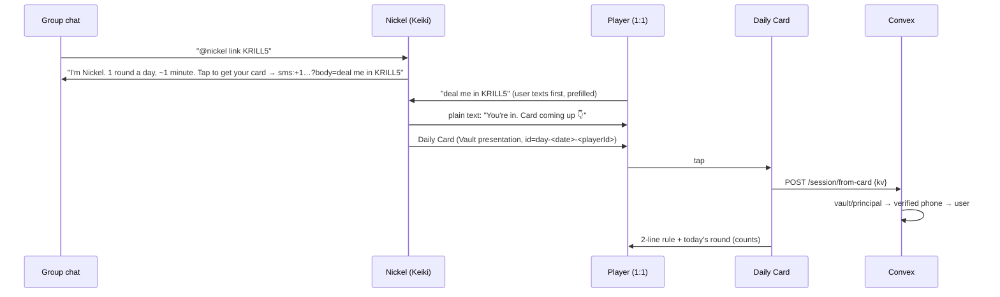

# Nickel UX Spec — Games in Keiki Vault, Results in the Group Chat

The decision: every game is played in a **Keiki Vault card** (our web page inside Messages, in a 1:1 chat with Nickel). The **group chat** is where rounds start, results land, and the trash talk happens.

This spec combines four research tracks. The full notes, with a source for every claim, are in [`research/imessage-ux/`](research/imessage-ux/):
1. Keiki Vault and the in-Messages browser it runs in
2. GamePigeon and other in-chat games
3. Apple's design guidelines, widgets, and Live Activities
4. Retention in social daily games

Tags used below: **[V]** means a source verifies it. **[I]** means it's a recommendation or inference, to be tested.

---

## Update (Nov 15): one link, one game, posted in the group

Testing the preview on a cloud iPhone changed two decisions below. Where they conflict, this section wins.

**Each card opens exactly one game.** No hub, no game picker. A round has its own URL, `/r/<roundId>`, and the server picks the screen from the round: the daily game, a head-to-head challenge, or yesterday's closed round. This replaces decision 1's Daily Card hub.

**The main path is a link in the group chat, not a Keiki Vault card.** Nickel posts the day's drop with one link at the end of the message. iMessage shows it as a large preview card in the group, and one tap opens that game in Safari. Moves are made on the page, never typed in the chat, so the group still can't see anyone's answer.

| | Link in the group (recommended) | Keiki Vault card in the 1:1 chat |
| :--- | :--- | :--- |
| Taps from seeing the drop to playing | 1 | 3 (open the Nickel chat, find the card, tap it) |
| Install | None | Keiki Vault from the App Store, once |
| Android and Mac friends | Works | Doesn't work |
| Identity | One-time "Which one are you?" plus one confirming text, then remembered | Automatic, from the `#kv` token |
| After a game ends | The group gets the result | The card still says "Your move", because Keiki can't edit a sent card [V] |
| Stays inside Messages | No. It opens Safari, and iOS shows "◀ Messages" to go back | Yes |

Use Vault only where it clearly earns the extra steps: a Face ID approval when real Nickels or money are staked.

**Gotchas for the link path:**
- iOS shows "Tap to Load Preview" instead of the big card when the sender isn't in the recipient's contacts [V messageflow.com]. Nickel's first private message should include its contact card, and onboarding should ask people to save it.
- Only one link per message gets a preview, and it previews best at the end of the text [V messageflow.com].
- Keiki's docs say links preview once the person has replied to the line [V imessage-best-practices.md]. Confirm the large preview on the real line.
- The page gets about 100pt less height in Safari than in a Vault card, because of Safari's toolbar. Every game screen must fit in that height without scrolling.

**Later, to keep play inside the group thread itself:** build our own iMessage app or an App Clip. Both need an Apple Developer account and a native build.

The clickable preview of both paths is in [`apps/preview/`](apps/preview/) (`node apps/preview/server.mjs`, then open `http://localhost:4173`).

---

## 0. The 15 decisions

1. **One card per player per day, not per round.** Keiki can't edit or update a sent card: "a tool cannot edit its own card; return a presentation with a new id" [V keiki-vault.md]. A card per round would bury each player's 1:1 chat in stale bubbles and burn the line's message budget. Instead, the **Daily Card** is a hub that moves through every round that day. Its `#kv` token lasts 24 hours [V].
2. **The group chat gets at most 3 bot messages per day:** the drop, a nudge only when needed, and the result. Reminders go 1:1. The only way a user can quiet the bot in a group is muting the whole chat, which also mutes their friends [V]. Restraint is how Nickel survives.
3. **Suspense lives in the card. The record lives in the chat.** The card plays the staged reveal; the chat gets one result message afterwards, never before. Otherwise the chat spoils the reveal for the slowest player [I].
4. **The game URL always returns HTTP 200.** Vault shows its own error and logs `card.load_failed` for any status of 400 or above [V]. Expired, finished, and unknown rounds all render our own friendly screen.
5. **The server owns all state, every clock, and every hidden answer.** The page can be killed at any moment, because Messages' web content process is disposable [V], so every load and every return to the foreground re-fetches state.
6. **Every move carries an idempotency key.** A duplicate submit returns the first result with status 200. The button flips to "Sent ✓" only after the server acknowledges it.
7. **No system keyboard, except in Krillion.** Wordle gets an in-page QWERTY, and the number games get an in-page number pad. The iOS keyboard in an embedded web view shifts layout around and has new bugs in 2026 [V].
8. **Live (in-bubble) cards are only for one-tap moments.** Vault 1.2.1 and earlier ignore taps on live cards [V], and a live bubble can't scroll [V]. That makes them right for Stop the Clock, RPS, Split or Steal, and Penalty Kick, and wrong for everything else.
9. **Haptics are a bonus, never the feedback itself.** iOS web has no vibration API [V], and the switch-control workaround is fragile [V]. Sound and motion carry the feedback, plus Nickel's native tapbacks and effects in the chat.
10. **The color palette is accessible by default.** Use orange and blue tiles, plus a glyph on each tile (✓ for right letter in the right spot, • for right letter in the wrong spot). Wordle's own high-contrast mode uses orange and blue, and almost nobody finds the toggle [V].
11. **Every round has a hard deadline.** Waiting on friends kills retention in chat games [V Instant Games teardown]. Turn-based head-to-head games get a "forfeit or bot takes over" option after a timeout.
12. **Every card has a plain-link fallback,** signed per player. It covers Android, people without Vault, failed or unknown deliveries, and Mac. Vault strips the `#kv` token in Safari [V], so the fallback link carries our own signature.
13. **The first card is the whole onboarding.** It needs no sign-in, because the `#kv` token proves the player's phone number, and it shows a 2-line rule and a 30-to-60-second first round that counts toward the standings.
14. **The group streak is forgiving and shared.** Each group starts with 2 freezes that Nickel applies automatically. It never names who broke a streak [V Duolingo data].
15. **Ask for native notifications only after the player's third game** (Vault's "Enable agent updates" flow). The iMessage text is always the guaranteed channel.

---

## 1. Surfaces and their jobs

| Surface | Job | What it can show |
| :--- | :--- | :--- |
| **Group chat** (Nickel bot) | Drop rounds, show who has played, the result record, polls, banter | Text, tapbacks, effects, polls, image carousel. **No cards** [V] |
| **1:1 chat with Nickel** | Delivers the Daily Card and private nudges | Text and cards. The card arrives only after the player has texted first [V line rules] |
| **Daily Card, expanded** | Where the games are played | Our web page, full height, opened by a tap |
| **Live card** (in the bubble) | One-tap games, plus a glanceable "3/5 played" | Our page inside the bubble. No scrolling; taps work on Vault 1.2.2 or later |
| **Vault notifications / Live Activity** | "Your turn", poach window, pot ticker | Text-only template (title up to 120 characters, body up to 500, progress bar), 8-hour cap, iOS 17.2+ for remote start. Opt-in after Face ID consent [V] |
| **Native widgets, custom Live Activities, haptics** | — | Need our own iOS app. Not in scope |

---

## 2. Core flows

### 2.1 First-time friend (zero-install path except Vault)

- **Install gap:** the first plain text also says once: *"Games open in the free Keiki Vault app (2 MB). If the card asks you to install it, that's why."* [I]
- **Without Vault, on Android, or on Mac:** the bot sends the signed link `/play/day/<date>?p=<id>&t=<hmac>`, and the same app runs in Safari or Chrome.

### 2.2 Daily loop

1. **Drop, at a time the group picks in a poll on day one** (default 12:30 local):
   `Today's Nickel: Wordle Blitz + Lowest Unique Number. Closes 9pm. Check your DM from me.`
2. Each player's 1:1 gets **one** Daily Card. Its caption reads `Nickel · Nov 15` and its subcaption `2 games · closes 9pm`.
3. The card opens on the next game the player hasn't played. Every completed round shows **Locked in ✓**, and the next game is one tap away.
4. **Progress in the group:** no message per player. Nickel puts one tapback on the drop message once half the group has played. [I]
5. **Nudge, 1:1 only,** 2 hours before close, only if the group streak is at risk:
   `Group streak is at 11. One more player keeps it alive 🧊`
6. **Close:** at the deadline, or as soon as everyone has played, the card unlocks its staged reveal (§4.3). Then the group gets one result message (§5.2).
7. **Afterglow:** a "Rematch tomorrow?" poll, or a head-to-head callout. Never a second scoreboard.

### 2.3 Head-to-head games (tic-tac-toe, Connect 4, Salvo, RPS, Split or Steal)

- One player challenges another: `@nickel challenge Dev to Connect 4`. Nickel posts one line in the group, and both players' Daily Cards gain a "vs Dev" tile. **No new card is needed.**
- **Simultaneous-move games** (RPS, Penalty Kick, Split or Steal, Sealed Bid) work as a commit and then a reveal, with no waiting on the other player's turn.
- **Turn-based games** (tic-tac-toe, Connect 4, Salvo) have a 4-hour turn timeout by default. After that the player can forfeit or let a bot take over. Nickel pings the player whose turn it is 1:1, once per turn, through a Vault notification if they're enrolled, otherwise a text.
- **Spectators** see the board in the group only when the game ends: a carousel of the final board, or for Salvo, the hit map.

---

## 3. Daily Card spec

### 3.1 Bubble (what sits in the transcript)
- **Caption** (up to 60 characters): state comes first, then the game: `Your move · Connect 4 vs Dev`, `2 games · closes 9pm`, `Results are in 🏆`. Captions can't change after sending [V]. So write captions that stay true all day: `Nickel · Nov 15` with subcaption `Tap to play`.
- **Live mode** only for a one-tap game card (§3.3).

### 3.2 Expanded layout (safe defaults until the size is measured on a device)
- The root is `position:fixed; inset:0; overflow:hidden; overscroll-behavior:none; touch-action:manipulation`, padded by `env(safe-area-inset-*)`.
- **Header, about 56pt:** the player's own avatar and name (a forwarded card visibly belongs to someone else), the group name, the pot or streak, and a close hint.
- **Game strip:** a pill per game (`Wordle ✓`, `Lowest # •`, `vs Dev ⏳`) with a deadline in tabular numbers.
- **Stage:** the game. A single fixed-ratio box that scales to the width of the card. **No scrolling during play.**
- **Footer:** one primary action, at least 44pt tall and full width, kept in the thumb zone.
- The page must work at the compact height (about keyboard height) and resize to expanded mid-session without losing state.

### 3.3 Live card (in-bubble)
- A 3:2 stage, a single big button, and a countdown. It's a separate tiny entry point (vanilla or React DOM only, under 150 KB gzipped of JS), because several old live bubbles may sit in the scrollback. It goes idle when hidden (timers stopped, polling stopped).
- If a tap does nothing (old Vault), the bubble's caption still says "Tap to play". So also open the expanded card on any tap the page can't handle. [I; test on Vault 1.2.1]

### 3.4 States every game screen must render (never a blank screen)

| State | What shows |
| :--- | :--- |
| Loading | Skeleton from static HTML: game name, countdown, avatars. First paint under 1 second |
| Not started | Two-line rule, "Start", the time limit |
| Playing | The game, the countdown, the move counter |
| Submitting | The move dims, with a spinner on the button. Input locked |
| Locked in | "Locked in ✓", who else has played (names only, no scores) |
| Waiting for the reveal | "Reveal at 9:00pm · 4/6 in", and a link to the next game |
| Reveal | Staged reveal (§4.3) |
| Done | Your result line, a "Copy result" button, Rematch / Next game |
| Round closed (late) | "Round closed 3 min ago. Play for practice?" |
| Offline | A banner saying "Reconnecting…". The move stays pending in an outbox |
| Expired or unknown card | "This card expired. Text 'deal me in' for today's." **Status 200** |
| Error | A plain sentence, "Try again", and a request id. Never a stack trace |

---

## 4. Per-game UI

| Game | Card mode | Input | Timer | In-card reveal | Group result line |
| :--- | :--- | :--- | :--- | :--- | :--- |
| **Wordle Blitz** | Expanded | In-page QWERTY. Guesses checked on the server | 45s, set by the server | Grids appear from last place to first | `Nickel Wordle #212 · 3/6 · 0:31` + grid |
| **One in a Krillion** | Expanded | Native text input (font at least 16pt, autocorrect off, `enterkeyhint=send`), placed in the top half | 25s | Rarity first ("Only 0.7% said this"), then the name | `Krillion #88 · 🦐🦐🦐🦐 Deep Cut · 850m` |
| **Lowest Unique Number / ⅔ Average / Closest Estimate** | Expanded | In-page number pad | Open until the deadline | Number line fills in pick by pick, winner last | `Lowest # · won with 7 · 3 collisions` |
| **Stop the Clock** | **Live** | One tap. Time measured on the server, compensating for half the round-trip | 15s | Instant time, rank later | `Stop the Clock · 9.98s 🔥` |
| **RPS / Penalty Kick / Odds-Evens** | **Live** | 3 big buttons | Until the deadline | Both moves flip together | `RPS vs Dev · won 2-1` |
| **Split or Steal / Sealed Bid** | **Live** (or a Face ID approval when Nickels are staked) | 2 buttons / number pad | Until the deadline | Dramatic reveal; save the effect for a betrayal | `Split or Steal · Dev stole 😈` |
| **Tic-tac-toe / Connect 4** | Expanded | Tap a cell or column | 4h per turn | Win line animates | `Connect 4 · Maya beat Dev in 14` |
| **5x5 Salvo** | Expanded | Tap 5 cells, then "Fire" | 20s salvo | Hits and sinks resolve | `Salvo · 4/6 hits · 1 sunk` |
| **Cup Pong / Hoops / Mini-golf** | Expanded, loaded in its own bundle, canvas capped at 2× pixel density | Swipe | 30s | Replay of the score | `Hoops · 5/5 rack 🏀` |

**Rules for every game:**
- A two-line rule appears on the first play only, with a "?" to see it again.
- Tie-break rules are written down and shown on the result ("Tie broken by time: 0:31 vs 0:38").
- No interstitials, ads, or upsells between a move and its submit. Ever.
- Result lines are fixed-format plain text that can be pasted anywhere and gives away no answers.

### 4.3 Staged reveal (in the card)
1. **Locked in** at 0s, the moment the player submits.
2. **Close-out:** "Round closed · 5 of 6 played · results in 3…".
3. **Count-up:** about 3 to 6 seconds, from last place to first, one line every 1.2 to 2 seconds. Each beat is an animation in the card, never a chat message.
4. **Peak:** the winner stands alone. For rarity games, show the stat first, then the name.
5. **Afterglow:** a "Copy result" button, plus Rematch or Next game.
6. With `prefers-reduced-motion`: the same order, crossfades only, total time about 1.5s.

---

## 5. Group chat design

### 5.1 Daily cadence (hard caps)

| Message | Maximum | When |
| :--- | :--- | :--- |
| Drop | 1 per day | At the group's chosen time |
| Nudge | 0 in the group (sent 1:1 instead) | — |
| Result | 1 per daily round | At close |
| Weekly recap + superlatives | 1 per week | Sunday 7pm, combined with that day's result |
| Head-to-head result | 1 per finished match | When the match ends |
| Quiet hours | None from 10pm to 8am local | Messages queue until morning |

Nickel's own tapbacks: at most 1 per round, on the winner's line. Effects only for: a 100-point Krillion, a Split or Steal betrayal, streak milestones (days 3, 7, 30, 100), and season payout.

### 5.2 Templates
- **Drop:** `Today's Nickel: Wordle Blitz 🟩 + Lowest Unique #. Closes 9pm. Check your DM from me.`
- **Result:** `🏆 Maya 3/6 · Dev 4/6 · Sam 5/6 · Alex didn't play`, with the image carousel only when there's a story (collisions, a Deep Cut).
- **Streak:** `Group streak: 12 days 🔥` / `Streak paused at 12 🧊 (freeze used)` / `Streak ended at 12. Longest ever: 12. New one starts today.`
- **Banter starter:** `Dev has beaten Maya 3 days running. Rematch Friday?` plus a poll.
- **Welcome:** `I'm Nickel. One round a day, about a minute. Say "nickel pause" anytime.`
- **Never:** guilt aimed at a named person, fake scarcity, "Don't miss out!", or a reminder to someone who has muted or paused.

### 5.3 Leaderboards for 3 to 12 friends
- Rank **today** and **this week** (resets Monday); keep season totals for Wrapped. Show the top 3 plus "you"; the full table goes in the carousel image.
- Score estimation games relative to the group median, and alternate skill games with luck or mind games so the winner keeps changing.
- Keep personal bests in the card, so last place still has something to celebrate.

---

## 6. Visual system for cards

- **Type:** system font stack (`-apple-system`), sized in `rem` so the player's text-size setting applies (test at 200%). Timers and pots use `font-variant-numeric: tabular-nums`.
- **Color:** dark-first, matching the app's obsidian and mint, with light-mode and increased-contrast variants. Set `<meta name="theme-color">` and the `html` background inline so the card has no white flash (Vault fills the card with the page's own color [V]).
- **Tiles:** orange = correct spot, blue = present elsewhere, gray = absent, each with a glyph and an aria-label. Never rely on color alone [V HIG].
- **Touch:** targets at least 44pt; pressed state painted on `pointerdown`; `touch-action:none` on canvases; `-webkit-user-select:none` and `-webkit-touch-callout:none` on game surfaces; inputs at least 16px (anything smaller makes iOS zoom in).
- **Motion:** feedback animations at most 300ms; 60fps for physics; `prefers-reduced-motion` swaps shakes and confetti for static changes.
- **Sound:** off by default with a visible toggle. The first "Start" tap sets `navigator.audioSession.type='playback'` and resumes the AudioContext.
- **Haptics:** one `haptic(kind)` helper that does nothing when unsupported (tick / confirm / error). Never the only feedback.
- **Accessibility:** VoiceOver labels on every tile and key; `aria-live=polite` for state changes; an untimed practice mode for every timed game.

---

## 7. Zero-error engineering contract

### 7.1 Page
- Static HTML via Expo Router's static export, with critical CSS and a skeleton inlined. Code split per route. Budgets: live card under 150 KB gzipped of JS; expanded card under 350 KB; physics games in their own lazy-loaded chunk. (react-native-web alone is about 75 KB gzipped [V].)
- On load: read `kv` → `POST /session/from-card` → clear the URL fragment with `history.replaceState` → `GET /day/:date/state`. Navigate with client-side routing only, because full-page navigations drop the fragment.
- Re-sync on `visibilitychange` and `pageshow`: resync the clock, re-fetch state, reconnect.
- No service worker; it won't run in Vault's web view [V]. localStorage is a cache only.

### 7.2 Network
- Typed client: 6-second timeout, 2 retries with backoff (300ms, then 900ms, with jitter), retrying only calls that are safe to repeat or carry an idempotency key.
- A move outbox keeps the move pending until the server acknowledges it. Live state comes from Convex subscriptions, with SSE or a 1.5-to-2-second poll as fallback. Always reconnect after the app returns from the background.
- Analytics use `fetch(..., {keepalive:true})` when the page hides. Game state never depends on unload events.

### 7.3 Server
- Each move carries an `Idempotency-Key` (a UUID that stays the same across retries). A unique (round, player, key) constraint plus "one answer per round" means a duplicate submit gets status 200 with the original result.
- Clock: 5 pings on load to measure the client's offset; countdown = server deadline minus (local time plus offset); re-sync every 30 seconds. A submit is accepted if it arrives by `closesAt` plus a grace of min(half the round-trip, 250ms); otherwise it gets status 409 `round_closed`, which the page shows as "Round closed". Rank by the server's receive time.
- Hidden information (the Wordle word, Salvo ships, bids) is never sent to the page before the reveal.
- Rate limits: 5 submits per second per player. Reaction times under 120ms are flagged, not blocked.

### 7.4 Card delivery (Keiki)

| `presentationDelivery` | Nickel does |
| :--- | :--- |
| `accepted` | Nothing (it doesn't mean the card was opened) |
| `unavailable` (`line_not_eligible`, `addon_disabled`, …) | Send the signed plain link as text |
| `failed` | Retry once with the **same id** (Keiki deduplicates by tool, id, and URL) |
| `unknown` | **Never resend.** Text "Don't see your card? → <link>" |

- Card id = `day-<YYYY-MM-DD>-<playerId>`, or `h2h-<matchId>-<playerId>`.
- Cards aren't sent in held-back or steered turns [V], so scheduled drops run as notice turns.
- **Line budget:** 6 players × 1 card plus about 4 texts is about 30 messages per group per day. One line (5,000 per day as a guideline, a hard cap of 50 new conversations per day [V]) carries about 100 or more active groups, if each player's first message is user-initiated (the `sms:` link). Spread drops over a few minutes; never burst.

---

## 8. Retention mechanics

- **Group streak:** a day counts when at least half the members (minimum 2) completed a round. Weekdays only by default; weekends are a bonus. 2 freezes at the start, plus 1 for every 7 days, capped at 2, all applied automatically. Celebrate days 3 and 7 the most [V Duolingo: early days drive retention].
- **Personal streak:** private, shown in the card only.
- **Rematch** is the primary button on every head-to-head result. The roster and series score carry over.
- **Superlatives,** weekly and positive-only ("Clutch Closer", "Most Unlucky", "Gone Fishing"), each member can opt out.
- **Pause:** "nickel pause" pauses the whole group, one tap from anyone. Never nudge someone who has muted or paused.
- **Money:** `ideas.md` already says to keep real money only in the season pot. The research adds that pooled real-money pots run by the app are legally narrow and vary by state. Get counsel before launch, and never pair money with streak pressure (§ research 04 section 9).

---

## 9. Native notifications and Live Activities (via Vault, opt-in)

- **Ask after the player's third finished game,** on the Done screen: "Want a heads-up when it's your move?" The bot then calls `vault_connect`, and the player approves with Face ID [V].
- **Use them for:** "Your move vs Dev" (turn-based), "Poach window open · ends 7:42pm", and a pot or round-window activity (rounds of 2 minutes or more only, and at most 8 hours).
- **Write absolute times** ("ends 7:42pm"), not countdowns. The template may not tick down on its own; ask Keiki. Keep lock-screen text spoiler-free ("Result is in", never the answer).
- **Never use them for** rounds under 30 seconds (push timing isn't guaranteed), or for marketing.

---

## 10. Test matrix (before the demo)

- iOS 17.0 and current (26.x); Vault **1.2.1** (expect live cards to ignore taps) and **1.2.4**.
- Compact → expanded resize mid-round; live card in the scrollback with 5 old live cards above it.
- Silent switch on/off, Low Power Mode, airplane mode mid-round, switching apps mid-round, a forced reload (the page getting killed).
- Double-tap submit, a retry after a timeout, a submit 100ms after close, and two devices opening the same forwarded card.
- Text size at 200%, VoiceOver, reduced motion, color-blind simulator.
- Android friend in the group (SMS fallback link), Mac Messages user, someone without Vault installed.
- A Keiki eval run on the group transcript: link, drop, 6 players, reveal, rematch poll. Check the bot's message count against the caps in §5.1.

---

## 11. Questions for Keiki (blockers for final layout)

1. Exact pixel size and aspect ratio of expanded (compact and full) and live cards, and whether the page can influence them. Does the web view report non-zero `env(safe-area-inset-*)`?
2. Do wss:// connections, cookies, and localStorage persist inside Vault's web view?
3. Can one dedicated line both send cards (1:1) and join group chats?
4. Does a Vault Live Activity render a ticking countdown from `expiresAt`?
5. How do developers read the `/vault/events` telemetry (`card.opened`, `card.dwell_ms`, `card.load_failed`)?
6. Is there any way to mark an old card as expired, or link cards with MSSession so a newer card replaces an older one?

---

## 12. Changes this implies for DESIGN.md / PLAN.md

- §5.2 Wordle's "live spectator masks streaming to the group": change to **in-card only**. In the group, show only who has played, until close.
- §8.2 tools: add `deal_in` (send or re-send the Daily Card by id), `challenge`, and `pause`; every tool gets an idempotency key and a signed context.
- One Daily Card per player per day replaces per-round cards everywhere.
- §4.2 poach window: notify 1:1 (or through a Vault notification), not as a group blast.
- Add a `/play/day/:date` hub route with the game strip, plus a separate `/live/:game` entry point.
